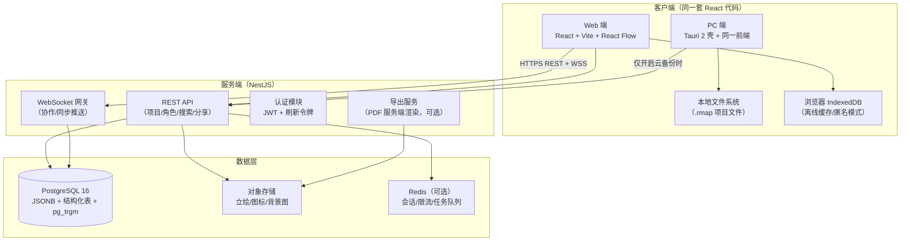
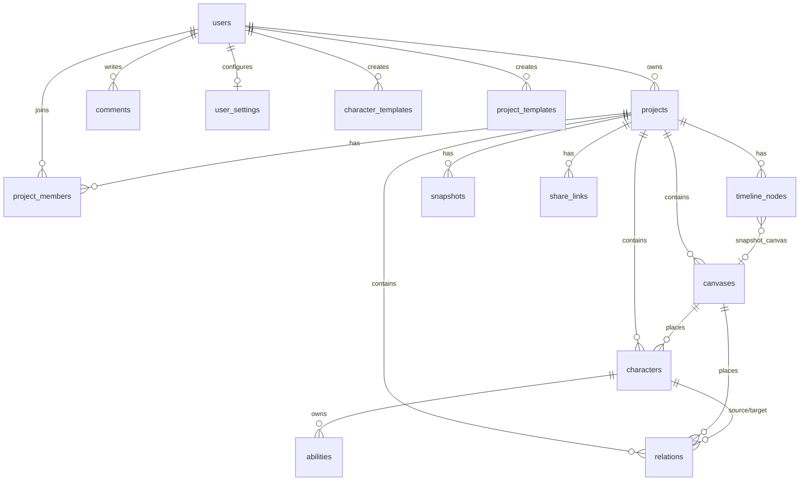

# 小说人物关系图工具 · 技术设计文档

| 项目 | 内容 |
| --- | --- |
| 文档版本 | v1.0 |
| 编写日期 | 2026-10-26 |
| 文档状态 | 评审稿 |
| 目标平台 | Web 端 + PC 桌面端（可执行文件） |
| 后端数据库 | PostgreSQL |

---

## 1. 项目概述

### 1.1 产品定位

本产品是一款用于展示小说人物关系的关系图工具，采用类思维导图的交互样式。用户以角色为节点、以关系为连线，可视化地梳理小说的人物网络。

### 1.2 设计目标

- **简洁**：上手成本低，核心操作（建角色、连线、标注关系）一步完成
- **便于操作**：完整的快捷键体系、批量操作、搜索过滤、时间轴等效率工具
- **可以传播**：支持导出图片/数据、生成只读分享链接、嵌入代码

### 1.3 交付策略

先做出可上线的 Web 版本，所有功能完成后，将同一套前端代码通过 Tauri 2 打包为可执行文件（PC 端）。

---

## 2. 技术栈总览

| 层级 | 技术选型 | 版本 | 选型理由 |
| --- | --- | --- | --- |
| 前端框架 | React + TypeScript | React 18 / TS 6.x | 生态成熟，类型安全，组件化适合画布类复杂 UI |
| 构建工具 | Vite | 8.x | 启动快、HMR 快，适配 Tauri 集成 |
| 状态管理 | Zustand | 5.x | 轻量、无样板代码，适合画布高频状态更新 |
| 画布引擎 | React Flow (@xyflow/react) | 12.x | 原生支持节点/连线/缩放/平移/小地图/多选/分组，自定义节点能力满足圆形/方形角色框需求 |
| 快捷键 | react-hotkeys-hook | 4.x | 声明式快捷键绑定，支持作用域与自定义映射 |
| UI 组件库 | Ant Design | 5.x | 中后台交互组件齐全（弹窗、表单、表格），加速侧边栏/设置/搜索面板开发 |
| 桌面端 | Tauri 2 | 2.x | 同一套前端代码打包为可执行文件，体积小（约 5-10MB）、内存占用低；通过 JS API 桥接本地文件系统 |
| 后端框架 | NestJS + TypeScript | 12.x | 模块化架构，REST + WebSocket 双通道原生支持，与前端同语言 |
| 数据库 | PostgreSQL | 16.x | 要求指定；JSONB 存画布序列化数据，pg_trgm 支持模糊搜索，行级安全/索引能力满足检索与权限需求 |
| 实时协作 | Yjs + y-protocols | 13.x | CRDT 算法，为第四版多人实时协作提供无冲突合并能力 |
| 对象存储 | S3 兼容（MinIO/OSS/COS） | — | 存储角色立绘、能力图标、背景图等用户上传资源 |
| 缓存/队列（可选） | Redis | 7.x | 会话、限流、快照清理定时任务队列 |

### 2.1 关键选型说明

1. **React Flow 而非 Konva/ECharts Graph**：React Flow 在节点编辑器场景（类似思维导图/流程图）是事实标准，自带缩放、平移、框选、小地图、分组（父节点）、自定义节点与边，可大幅减少自研工作量；Konva 更底层，自定义能力强但开发成本高。
2. **Tauri 而非 Electron**：Tauri 2 打包体积约为 Electron 的 1/10~1/20，内存占用低，满足"打包成可执行文件"且对体积敏感的目标；前端代码与 Web 端 100% 复用，通过 `@tauri-apps/api` 的 fs/dialog 插件访问本地文件。
3. **PostgreSQL JSONB + 结构化双轨存储**：画布渲染状态（节点坐标、边路径）以 React Flow 序列化 JSON 存入 JSONB；角色、关系、能力等业务实体同步建结构化表，支撑搜索、过滤、统计与协作。
4. **Yjs 预埋**：第一至三版不做实时协作，但数据模型与存储层按"可合并的文档"设计，第四版引入 Yjs 时无需重构。

---

## 3. 系统架构

### 3.1 总体架构图



### 3.2 前端架构（Web 与 PC 共用）

```
src/
├── components/
│   ├── canvas/            # 画布：CharacterNode、RelationEdge、Toolbar、MiniMap、TimelineBar
│   ├── sidebar/           # 侧边栏：文件树、最近项目、快捷键表
│   ├── panels/            # 搜索面板、历史面板、图层面板、模板面板
│   ├── modals/            # 角色详情、能力编辑、冲突解决、分享设置
│   └── settings/          # 设置页
├── store/                 # Zustand：projectStore、canvasStore、timelineStore、uiStore、syncStore
├── core/
│   ├── storage/           # 存储适配层：CloudStorage（REST）/ LocalStorage（Tauri FS / IndexedDB）
│   ├── exporter/          # PNG/JPG/SVG/JSON/Markdown/PDF 导出
│   ├── importer/          # 文本/CSV/Excel/XMind 导入
│   ├── history/           # 撤销/重做（命令栈）与历史面板
│   ├── sync/              # 自动保存调度、离线缓存、冲突检测
│   └── shortcuts/         # 键位映射与分发
└── api/                   # REST 客户端、WebSocket 客户端（预留协作）
```

**存储适配层（StorageAdapter）**是关键抽象：定义统一接口 `load/save/rename/delete/list/recent`，Web 端实现为 REST 云端实现，PC 端默认实现为 Tauri 本地文件实现、可选切换为云端实现（用户在设置中开启"上传到服务器"）。

### 3.3 后端架构（NestJS 模块）

| 模块 | 职责 |
| --- | --- |
| `AuthModule` | 注册/登录（含匿名会话）、JWT 签发与刷新、账户注销（级联删除数据，GDPR） |
| `ProjectsModule` | 项目 CRUD、最近列表、重命名、删除 |
| `CanvasModule` | 画布节点/边 JSONB 读写、乐观锁版本控制、自动保存接收 |
| `CharactersModule` | 角色/能力/关系结构化数据 CRUD（与画布 JSON 双向同步） |
| `SearchModule` | 角色/关系/能力/标签搜索与过滤（pg_trgm 模糊匹配） |
| `TimelineModule` | 时间轴节点、快照/差异模式数据管理 |
| `SnapshotsModule` | 版本快照创建/比较/恢复、保留策略定时清理（Cron） |
| `ShareModule` | 分享链接生成/校验（公开/私密/密码）、嵌入页数据下发 |
| `CommentsModule` | 评论、@提及、通知（第四版） |
| `CollabModule` | WebSocket 房间管理、Yjs 文档同步、在线状态（第四版） |
| `TemplatesModule` | 角色/关系/项目模板 |
| `FilesModule` | 立绘/图标/背景图上传，S3 对象存储 |

### 3.4 Web 与 PC 数据流差异

| 场景 | Web 端 | PC 端 |
| --- | --- | --- |
| 数据保存位置 | 云端 PostgreSQL（首次保存前弹窗提醒"文件将上传到云端数据库，请勿上传隐私信息"） | 本地 `.rmap` 文件（Tauri FS）；设置中可开启云备份（开启时弹窗提醒） |
| 自动保存 | 每 3 分钟定时 + 手动保存按钮 + `Ctrl/Cmd + S` | 编辑防抖本地写盘 + 手动保存；开启云备份后同 Web 端 3 分钟策略 |
| 离线编辑 | IndexedDB 本地缓存，恢复网络后同步 | 天然支持（本地文件）；上线后自动同步云端 |
| 文件操作 | 文件选择器上传/下载 | 系统原生文件对话框（Tauri dialog 插件） |
| 匿名模式 | 无需注册，数据仅存 IndexedDB，清浏览器即删除 | 不适用（本地文件天然无需账户） |

---

## 4. 数据模型设计（PostgreSQL）

### 4.1 ER 关系总览



### 4.2 表结构明细

#### 4.2.1 users — 用户

| 字段 | 类型 | 约束 | 说明 |
| --- | --- | --- | --- |
| id | UUID | PK, 默认 gen_random_uuid() | 用户主键 |
| email | CITEXT | UNIQUE, 可空 | 邮箱（匿名用户为空） |
| password_hash | TEXT | 可空 | argon2id 哈希（匿名用户为空） |
| nickname | TEXT | NOT NULL | 昵称 |
| avatar_url | TEXT | 可空 | 头像地址 |
| is_anonymous | BOOLEAN | 默认 false | 匿名模式标记 |
| created_at / updated_at | TIMESTAMPTZ | 默认 now() | 时间戳 |
| deleted_at | TIMESTAMPTZ | 可空 | 软删除（注销后 7 天物理删除） |

#### 4.2.2 projects — 项目（文件）

| 字段 | 类型 | 约束 | 说明 |
| --- | --- | --- | --- |
| id | UUID | PK | 项目主键 |
| owner_id | UUID | FK → users, NOT NULL | 所有者 |
| name | TEXT | NOT NULL | 项目名（主界面与侧边栏展示） |
| description | TEXT | 可空 | 项目简介 |
| cover_image | TEXT | 可空 | 封面图（主界面卡片） |
| timeline_mode | TEXT | CHECK ('snapshot','diff')，默认 'snapshot' | 时间轴模式（项目级设置） |
| current_version | INT | 默认 1 | 乐观锁版本号，冲突检测依据 |
| local_only | BOOLEAN | 默认 false | 仅本地存储标记（PC 端） |
| last_modified_at | TIMESTAMPTZ | 索引 | 最近修改时间（最近打开列表排序依据） |
| created_at / updated_at / deleted_at | TIMESTAMPTZ | — | 时间戳 |

#### 4.2.3 canvases — 画布

React Flow 渲染状态与项目设置的持久化载体。

| 字段 | 类型 | 约束 | 说明 |
| --- | --- | --- | --- |
| id | UUID | PK | 画布主键（时间轴快照模式中每个时间节点对应一张画布） |
| project_id | UUID | FK → projects, NOT NULL | 所属项目 |
| name | TEXT | 默认 '默认画布' | 画布名 |
| nodes | JSONB | NOT NULL, 默认 '[]' | React Flow 节点序列化数组（含角色节点/分组/标注/便签） |
| edges | JSONB | NOT NULL, 默认 '[]' | React Flow 边序列化数组（关系线及样式） |
| viewport | JSONB | 默认 '{"x":0,"y":0,"zoom":1}' | 视口状态（位置与缩放，跨会话保留） |
| settings | JSONB | 默认 '{}' | 画布设置：背景（颜色/图片/透明度）、能力图标开关、时间轴显示状态 |
| version | INT | 默认 1 | 乐观锁版本号 |
| updated_at | TIMESTAMPTZ | 默认 now() | 更新时间 |

`settings` JSONB 结构：

```json
{
  "background": { "type": "color", "value": "#ffffff", "opacity": 1 },
  "abilityIconEnabled": false,
  "timelineVisible": true
}
```

#### 4.2.4 characters — 角色（结构化冗余）

角色同时存在于 `canvases.nodes`（渲染）与本表（业务检索），通过 `node_id` 关联。写入时由后端事务保证双侧一致。

| 字段 | 类型 | 约束 | 说明 |
| --- | --- | --- | --- |
| id | UUID | PK | 角色主键（与 node id 同源） |
| project_id | UUID | FK → projects | 所属项目 |
| canvas_id | UUID | FK → canvases | 所在画布（时间轴快照下每节点独立） |
| node_id | TEXT | NOT NULL | 对应 React Flow node id |
| shape | TEXT | CHECK ('circle','square')，默认 'circle' | 角色框形状（圆形/方形） |
| name | TEXT | NOT NULL | 姓名（必选） |
| gender | TEXT | NOT NULL | 性别（必选） |
| avatar_url | TEXT | 可空 | 角色立绘地址（可选，默认占位图） |
| faction | TEXT | 可空 | 阵营（可选，过滤维度） |
| tags | TEXT[] | 默认 '{}'，GIN 索引 | 标签（可选，搜索维度） |
| attributes | JSONB | 默认 '{}' | 自定义属性键值对（可选） |
| x / y | DOUBLE PRECISION | 可空 | 节点坐标冗余（供 SQL 空间过滤，渲染以 nodes JSONB 为准） |
| created_at / updated_at | TIMESTAMPTZ | — | 时间戳 |

#### 4.2.5 abilities — 能力（技能）

| 字段 | 类型 | 约束 | 说明 |
| --- | --- | --- | --- |
| id | UUID | PK | 能力主键 |
| character_id | UUID | FK → characters ON DELETE CASCADE | 所属角色 |
| name | TEXT | NOT NULL | 能力名称 |
| detail | TEXT | 可空 | 能力详细信息（仅编辑弹窗内可修改） |
| icon_url | TEXT | 可空 | 技能图标（为空时使用默认图标） |
| sort_order | INT | 默认 0 | 展示顺序 |
| created_at / updated_at | TIMESTAMPTZ | — | 时间戳 |

#### 4.2.6 relations — 关系

| 字段 | 类型 | 约束 | 说明 |
| --- | --- | --- | --- |
| id | UUID | PK | 关系主键（与 edge id 同源） |
| project_id | UUID | FK → projects | 所属项目 |
| canvas_id | UUID | FK → canvases | 所在画布 |
| edge_id | TEXT | NOT NULL | 对应 React Flow edge id |
| source_character_id | UUID | FK → characters | 起点角色 |
| target_character_id | UUID | FK → characters | 终点角色 |
| relation_type | TEXT | 可空 | 关系类型（朋友/敌人/师徒/恋人/父子/同事/自定义） |
| label | TEXT | 可空 | 线上标注文本 |
| style | JSONB | 默认 '{}' | 样式：颜色、粗细、边框类型（实线/虚线/双线等） |

#### 4.2.7 timeline_nodes — 时间轴节点

| 字段 | 类型 | 约束 | 说明 |
| --- | --- | --- | --- |
| id | UUID | PK | 时间节点主键 |
| project_id | UUID | FK → projects | 所属项目 |
| name | TEXT | NOT NULL | 节点名，默认"时间节点n"（n = 当前节点数 + 1），可重命名 |
| position | INT | NOT NULL | 时间轴上的顺序 |
| snapshot_canvas_id | UUID | FK → canvases, 可空 | 快照模式：复制出的画布 |
| base_canvas_id | UUID | FK → canvases, 可空 | 差异模式：基础画布引用 |
| delta | JSONB | 可空 | 差异模式：RFC 6902 JSON Patch 数组（相对基础画布的变化） |
| created_at | TIMESTAMPTZ | 默认 now() | 创建时间 |

#### 4.2.8 snapshots — 版本快照

| 字段 | 类型 | 约束 | 说明 |
| --- | --- | --- | --- |
| id | UUID | PK | 快照主键 |
| project_id | UUID | FK → projects | 所属项目 |
| name | TEXT | NOT NULL | 快照名（自动快照以时间命名） |
| data | JSONB | NOT NULL | 完整项目数据（画布 + 角色 + 关系 + 时间轴） |
| is_auto | BOOLEAN | 默认 false | 手动/自动快照 |
| created_by | UUID | FK → users, 可空 | 创建人 |
| created_at | TIMESTAMPTZ | 索引 | 时间戳（保留策略依据） |

#### 4.2.9 share_links — 分享链接

| 字段 | 类型 | 约束 | 说明 |
| --- | --- | --- | --- |
| id | UUID | PK | 主键 |
| project_id | UUID | FK → projects | 被分享项目 |
| token | TEXT | UNIQUE, NOT NULL | 随机 256 位令牌（URL 中的只读凭证） |
| permission | TEXT | CHECK ('public','private','password') | 公开/私密/密码保护 |
| password_hash | TEXT | 可空 | permission = 'password' 时存 argon2id 哈希 |
| embed_allowed | BOOLEAN | 默认 false | 是否允许 iframe 嵌入 |
| expires_at | TIMESTAMPTZ | 可空 | 过期时间（空 = 永久） |
| created_by / created_at | — | — | 创建信息 |

#### 4.2.10 project_members — 协作成员（第四版）

| 字段 | 类型 | 约束 | 说明 |
| --- | --- | --- | --- |
| project_id | UUID | PK 组成, FK → projects | 项目 |
| user_id | UUID | PK 组成, FK → users | 成员 |
| role | TEXT | CHECK ('owner','editor','viewer') | 所有者/编辑者/查看者 |
| invited_at | TIMESTAMPTZ | — | 邀请时间 |

#### 4.2.11 comments — 评论（第四版）

| 字段 | 类型 | 约束 | 说明 |
| --- | --- | --- | --- |
| id | UUID | PK | 主键 |
| project_id | UUID | FK → projects | 所属项目 |
| target_type | TEXT | CHECK ('character','relation','canvas','annotation') | 评论挂载对象类型 |
| target_id | UUID | NOT NULL | 对象 id |
| user_id | UUID | FK → users | 评论人 |
| parent_id | UUID | 可空 | 父评论（回复） |
| content | TEXT | NOT NULL | 内容 |
| mentions | UUID[] | 默认 '{}' | @提及的用户 id |
| resolved | BOOLEAN | 默认 false | 已解决标记 |
| created_at / updated_at | TIMESTAMPTZ | — | 时间戳 |

#### 4.2.12 模板表（三张）

| 表 | 关键字段 | 说明 |
| --- | --- | --- |
| character_templates | id, owner_id(可空=系统预设), name, type CHECK ('protagonist','supporting','villain','extra','custom'), fields JSONB, is_system | 主角/配角/反派/路人预设属性字段；用户可另存自定义模板 |
| relation_templates | id, owner_id, name, relation_type, style JSONB, is_system | 朋友/敌人/师徒/恋人/父子/同事预设，含默认颜色与样式 |
| project_templates | id, owner_id, name, data JSONB, is_system | 空白项目、示例项目（"三国人物关系"）、用户项目另存为模板 |

#### 4.2.13 user_settings — 用户设置

| 字段 | 类型 | 约束 | 说明 |
| --- | --- | --- | --- |
| user_id | UUID | PK, FK → users | 用户 |
| settings | JSONB | 默认 '{}' | 个性化设置（键位映射、画布背景、能力图标开关、自动保存间隔、云备份开关） |
| updated_at | TIMESTAMPTZ | — | 更新时间 |

`settings` JSONB 结构：

```json
{
  "keybindings": { "save": "mod+s", "createCharacter": "mod+alt+enter", "toggleTimeline": "mod+alt+p" },
  "canvasBackground": { "type": "image", "url": "s3://...", "opacity": 0.8 },
  "abilityIconEnabled": false,
  "cloudBackupEnabled": false,
  "autosaveIntervalSeconds": 180
}
```

### 4.3 核心 DDL

```sql
CREATE EXTENSION IF NOT EXISTS pg_trgm;
CREATE EXTENSION IF NOT EXISTS pgcrypto;

CREATE TABLE users (
    id              UUID PRIMARY KEY DEFAULT gen_random_uuid(),
    email           CITEXT UNIQUE,
    password_hash   TEXT,
    nickname        TEXT NOT NULL,
    avatar_url      TEXT,
    is_anonymous    BOOLEAN NOT NULL DEFAULT FALSE,
    created_at      TIMESTAMPTZ NOT NULL DEFAULT now(),
    updated_at      TIMESTAMPTZ NOT NULL DEFAULT now(),
    deleted_at      TIMESTAMPTZ
);

CREATE TABLE projects (
    id               UUID PRIMARY KEY DEFAULT gen_random_uuid(),
    owner_id         UUID NOT NULL REFERENCES users(id),
    name             TEXT NOT NULL,
    description      TEXT,
    cover_image      TEXT,
    timeline_mode    TEXT NOT NULL DEFAULT 'snapshot'
                     CHECK (timeline_mode IN ('snapshot','diff')),
    current_version  INTEGER NOT NULL DEFAULT 1,
    local_only       BOOLEAN NOT NULL DEFAULT FALSE,
    last_modified_at TIMESTAMPTZ NOT NULL DEFAULT now(),
    created_at       TIMESTAMPTZ NOT NULL DEFAULT now(),
    updated_at       TIMESTAMPTZ NOT NULL DEFAULT now(),
    deleted_at       TIMESTAMPTZ
);
CREATE INDEX idx_projects_owner ON projects(owner_id) WHERE deleted_at IS NULL;
CREATE INDEX idx_projects_recent ON projects(owner_id, last_modified_at DESC) WHERE deleted_at IS NULL;

CREATE TABLE canvases (
    id          UUID PRIMARY KEY DEFAULT gen_random_uuid(),
    project_id  UUID NOT NULL REFERENCES projects(id) ON DELETE CASCADE,
    name        TEXT NOT NULL DEFAULT '默认画布',
    nodes       JSONB NOT NULL DEFAULT '[]',
    edges       JSONB NOT NULL DEFAULT '[]',
    viewport    JSONB NOT NULL DEFAULT '{"x":0,"y":0,"zoom":1}',
    settings    JSONB NOT NULL DEFAULT '{}',
    version     INTEGER NOT NULL DEFAULT 1,
    updated_at  TIMESTAMPTZ NOT NULL DEFAULT now()
);
CREATE INDEX idx_canvases_project ON canvases(project_id);

CREATE TABLE characters (
    id          UUID PRIMARY KEY DEFAULT gen_random_uuid(),
    project_id  UUID NOT NULL REFERENCES projects(id) ON DELETE CASCADE,
    canvas_id   UUID NOT NULL REFERENCES canvases(id) ON DELETE CASCADE,
    node_id     TEXT NOT NULL,
    shape       TEXT NOT NULL DEFAULT 'circle' CHECK (shape IN ('circle','square')),
    name        TEXT NOT NULL,
    gender      TEXT NOT NULL,
    avatar_url  TEXT,
    faction     TEXT,
    tags        TEXT[] NOT NULL DEFAULT '{}',
    attributes  JSONB NOT NULL DEFAULT '{}',
    x           DOUBLE PRECISION,
    y           DOUBLE PRECISION,
    created_at  TIMESTAMPTZ NOT NULL DEFAULT now(),
    updated_at  TIMESTAMPTZ NOT NULL DEFAULT now()
);
CREATE INDEX idx_characters_project ON characters(project_id);
CREATE INDEX idx_characters_name_trgm ON characters USING gin (name gin_trgm_ops);
CREATE INDEX idx_characters_tags ON characters USING gin (tags);
CREATE INDEX idx_characters_gender ON characters(gender);
CREATE INDEX idx_characters_faction ON characters(faction);

CREATE TABLE abilities (
    id            UUID PRIMARY KEY DEFAULT gen_random_uuid(),
    character_id  UUID NOT NULL REFERENCES characters(id) ON DELETE CASCADE,
    name          TEXT NOT NULL,
    detail        TEXT,
    icon_url      TEXT,
    sort_order    INTEGER NOT NULL DEFAULT 0,
    created_at    TIMESTAMPTZ NOT NULL DEFAULT now(),
    updated_at    TIMESTAMPTZ NOT NULL DEFAULT now()
);
CREATE INDEX idx_abilities_name_trgm ON abilities USING gin (name gin_trgm_ops);

CREATE TABLE relations (
    id                   UUID PRIMARY KEY DEFAULT gen_random_uuid(),
    project_id           UUID NOT NULL REFERENCES projects(id) ON DELETE CASCADE,
    canvas_id            UUID NOT NULL REFERENCES canvases(id) ON DELETE CASCADE,
    edge_id              TEXT NOT NULL,
    source_character_id  UUID NOT NULL REFERENCES characters(id) ON DELETE CASCADE,
    target_character_id  UUID NOT NULL REFERENCES characters(id) ON DELETE CASCADE,
    relation_type        TEXT,
    label                TEXT,
    style                JSONB NOT NULL DEFAULT '{}',
    created_at           TIMESTAMPTZ NOT NULL DEFAULT now(),
    updated_at           TIMESTAMPTZ NOT NULL DEFAULT now()
);
CREATE INDEX idx_relations_project ON relations(project_id);
CREATE INDEX idx_relations_type_trgm ON relations USING gin (relation_type gin_trgm_ops);

CREATE TABLE timeline_nodes (
    id                  UUID PRIMARY KEY DEFAULT gen_random_uuid(),
    project_id          UUID NOT NULL REFERENCES projects(id) ON DELETE CASCADE,
    name                TEXT NOT NULL,
    position            INTEGER NOT NULL,
    snapshot_canvas_id  UUID REFERENCES canvases(id) ON DELETE CASCADE,
    base_canvas_id      UUID REFERENCES canvases(id) ON DELETE CASCADE,
    delta               JSONB,
    created_at          TIMESTAMPTZ NOT NULL DEFAULT now()
);
CREATE INDEX idx_timeline_project ON timeline_nodes(project_id, position);

CREATE TABLE snapshots (
    id          UUID PRIMARY KEY DEFAULT gen_random_uuid(),
    project_id  UUID NOT NULL REFERENCES projects(id) ON DELETE CASCADE,
    name        TEXT NOT NULL,
    data        JSONB NOT NULL,
    is_auto     BOOLEAN NOT NULL DEFAULT FALSE,
    created_by  UUID REFERENCES users(id),
    created_at  TIMESTAMPTZ NOT NULL DEFAULT now()
);
CREATE INDEX idx_snapshots_project ON snapshots(project_id, created_at DESC);

CREATE TABLE share_links (
    id             UUID PRIMARY KEY DEFAULT gen_random_uuid(),
    project_id     UUID NOT NULL REFERENCES projects(id) ON DELETE CASCADE,
    token          TEXT NOT NULL UNIQUE,
    permission     TEXT NOT NULL DEFAULT 'public'
                   CHECK (permission IN ('public','private','password')),
    password_hash  TEXT,
    embed_allowed  BOOLEAN NOT NULL DEFAULT FALSE,
    expires_at     TIMESTAMPTZ,
    created_by     UUID REFERENCES users(id),
    created_at     TIMESTAMPTZ NOT NULL DEFAULT now()
);

CREATE TABLE project_members (
    project_id  UUID NOT NULL REFERENCES projects(id) ON DELETE CASCADE,
    user_id     UUID NOT NULL REFERENCES users(id),
    role        TEXT NOT NULL DEFAULT 'viewer'
                CHECK (role IN ('owner','editor','viewer')),
    invited_at  TIMESTAMPTZ NOT NULL DEFAULT now(),
    PRIMARY KEY (project_id, user_id)
);

CREATE TABLE comments (
    id          UUID PRIMARY KEY DEFAULT gen_random_uuid(),
    project_id  UUID NOT NULL REFERENCES projects(id) ON DELETE CASCADE,
    target_type TEXT NOT NULL CHECK (target_type IN ('character','relation','canvas','annotation')),
    target_id   UUID NOT NULL,
    user_id     UUID NOT NULL REFERENCES users(id),
    parent_id   UUID,
    content     TEXT NOT NULL,
    mentions    UUID[] NOT NULL DEFAULT '{}',
    resolved    BOOLEAN NOT NULL DEFAULT FALSE,
    created_at  TIMESTAMPTZ NOT NULL DEFAULT now(),
    updated_at  TIMESTAMPTZ NOT NULL DEFAULT now()
);

CREATE TABLE user_settings (
    user_id     UUID PRIMARY KEY REFERENCES users(id) ON DELETE CASCADE,
    settings    JSONB NOT NULL DEFAULT '{}',
    updated_at  TIMESTAMPTZ NOT NULL DEFAULT now()
);

CREATE TABLE character_templates (
    id         UUID PRIMARY KEY DEFAULT gen_random_uuid(),
    owner_id   UUID REFERENCES users(id),
    name       TEXT NOT NULL,
    type       TEXT NOT NULL CHECK (type IN ('protagonist','supporting','villain','extra','custom')),
    fields     JSONB NOT NULL DEFAULT '{}',
    is_system  BOOLEAN NOT NULL DEFAULT FALSE
);

CREATE TABLE relation_templates (
    id            UUID PRIMARY KEY DEFAULT gen_random_uuid(),
    owner_id      UUID REFERENCES users(id),
    name          TEXT NOT NULL,
    relation_type TEXT,
    style         JSONB NOT NULL DEFAULT '{}',
    is_system     BOOLEAN NOT NULL DEFAULT FALSE
);

CREATE TABLE project_templates (
    id         UUID PRIMARY KEY DEFAULT gen_random_uuid(),
    owner_id   UUID REFERENCES users(id),
    name       TEXT NOT NULL,
    data       JSONB NOT NULL,
    is_system  BOOLEAN NOT NULL DEFAULT FALSE,
    created_at TIMESTAMPTZ NOT NULL DEFAULT now()
);
```

### 4.4 PC 端本地文件格式（.rmap）

PC 端默认不依赖数据库，项目保存为单个 `.rmap` 文件（JSON 格式，UTF-8）：

```json
{
  "format": "rmap",
  "version": 1,
  "project": { "name": "示例项目", "timelineMode": "snapshot" },
  "canvases": [
    {
      "id": "c1",
      "name": "默认画布",
      "nodes": [],
      "edges": [],
      "viewport": { "x": 0, "y": 0, "zoom": 1 },
      "settings": {}
    }
  ],
  "characters": [],
  "relations": [],
  "abilities": [],
  "timeline": [],
  "assets": { "<assetId>": "data:image/png;base64,..." }
}
```

说明：图片资源默认以 Base64 内嵌进 `assets`（保证单文件可传播）；文件超过阈值（如 20MB）时，PC 端改为侧车目录 `项目名.assets/` 存放原始图片并在 JSON 中引用相对路径。云端备份时 JSONB 结构与 4.2 表结构一一映射。

---

## 5. 核心模块技术设计

### 5.1 主界面与侧边栏

**主界面**（图片 1：main_interface）

- 布局：左侧侧边栏（可折叠）+ 右侧内容区。
- 侧边栏顶部为"新建文件"、"打开文件"两个入口：
  - Web 端：新建 → 创建项目并进入工作区；打开 → 文件选择器上传 `.rmap`/`.json` 或从云端项目列表选择。
  - PC 端：通过 Tauri dialog 插件调用系统原生文件对话框；新建走系统"另存为"流程确定路径。
- 内容区为**最近打开的项目**列表（卡片/表格），每条显示：项目名、最近修改时间（`projects.last_modified_at`）。PC 端本地模式下从本地目录扫描 `.rmap` 文件，将文件 mtime 作为最近修改时间。
- 侧边栏文件功能：打开编辑、重命名、保存到本地、下载到本地（Web 端）、删除（二次确认）、展开/收起按钮（CSS 宽度过渡，状态持久化到 `user_settings`）、快捷键表入口（弹窗列出 5.8 全部快捷键）。

### 5.2 画布工作区（React Flow）

**组件结构**

- `<CanvasEditor>`：React Flow 根组件，管理 nodes/edges/viewport 状态（Zustand `canvasStore`）。
- `<CharacterNode>`：自定义节点，圆形（默认）或方形，`borderRadius` 依据 `shape` 字段切换；选中态/悬浮态/搜索命中高亮态三种视觉状态。
- `<RelationEdge>`：自定义边，支持箭头（`markerEnd`）、矩形/圆形端点装饰、线上 label 标注。
- `<CanvasToolbar>`：顶部工具栏。

**核心交互实现**

| 需求 | 实现方案 |
| --- | --- |
| 创建角色（圆形/方形） | 双击画布或 `Ctrl/Cmd + Alt + Enter` 创建；创建弹窗先选形状（默认圆形），确认后在点击位置 `screenToFlowPosition` 放置节点，同时写 `characters` 表 |
| 新建工作区自动生成空角色 | 项目初始化时写入一个空角色节点，节点内显示提示文案"Ctrl/Cmd + Alt + 回车：创建新角色"（占位符样式，填写姓名后消失） |
| 悬浮显示角色详情 | `onNodeMouseEnter/Move/Leave` 控制 Tooltip（Portal 渲染），内容从 `characters` 读取；移开即销毁。详情面板显示：立绘（无则默认占位图）、姓名、性别、能力列表、属性、阵营 |
| 连接角色 | 工具栏切换模式（箭头/矩形/圆形线条样式），拖拽节点 handle 到目标节点生成 edge，弹出关系标注输入框（关系类型 + 文字） |
| 修改形状样式 | 选中节点/边后右侧属性面板：颜色（调色板）、粗细（1-8px 滑杆）、边框类型（实线/虚线/点线/双线，对应 SVG `strokeDasharray`） |
| 批量选择 | React Flow 原生框选（`selectionOnDrag`）、`Ctrl/Cmd + 点击` 多选、`Ctrl/Cmd + A` 全选、工具栏"选择同类型对象"（按 shape/关系类型过滤后加入选区） |
| 平移画布 | 拖动空白处 / 空格+拖动（自定义空格按下临时开启 `panOnDrag`） |

**性能目标**：单画布 500 节点内保持 60fps；超过时对节点渲染做虚拟化（仅渲染视口内节点，React Flow `onlyRenderVisibleElements`）。

### 5.3 角色详细信息（编辑弹窗）

- 表单字段：立绘（上传，未上传显示默认占位属性）、姓名（必填）、性别（必填）、能力列表（可增删改，见 5.4）、属性（键值对动态表单）、阵营、标签。
- 校验：姓名、性别必填，其余可空；前端 antd Form 校验 + 后端 DTO class-validator 双重校验。
- 保存：更新 `characters` 表与画布节点 `data`（事务内同步）。

### 5.4 能力详细信息（一行布局与响应式）

能力项在一行内包含四个 box：**图标 | 技能名 | 感叹号 icon | 编辑按钮**，边界关系规则：

| 交互 | 行为 |
| --- | --- |
| 默认 | 显示"图标 + 技能名"；图标未开启时隐藏图标位 |
| 悬浮感叹号 | Popover 显示能力详细信息（只读，不进入编辑态） |
| 点击编辑按钮 | 打开编辑弹窗（唯一可修改能力名称与详细信息的入口） |
| 长技能名 | CSS `text-overflow: ellipsis` 截断，悬浮显示完整名称（Tooltip） |
| 宽屏 | 一行显示全部四元素 |
| 窄屏 | 编辑按钮固定到行右侧 |
| 小屏 | 编辑按钮收进悬浮菜单（三个点按钮展开） |

- 能力图标：设置中开启"为能力添加图标"（默认关闭）后，所有技能显示图标位；未上传时显示内置默认图标；图标显示在技能名左侧。
- 响应式实现：CSS Grid 布局 + 媒体查询断点（`lg/md/sm`），与需求三档对应。

### 5.5 设置（个性化）

| 设置项 | 存储 | 实现说明 |
| --- | --- | --- |
| 画布背景：颜色/图片 + 透明度 | `canvases.settings.background`（持久化） | 颜色为纯色填充；图片走对象存储/本地资源；透明度作用于背景层（CSS opacity），不影响节点 |
| 时间轴显示 | `canvases.settings.timelineVisible` | 默认开启，以 70% 透明度渲染在工作区上方、工具栏下方（`TimelineBar` 组件，`opacity: 0.7`） |
| 能力图标开关 | `user_settings.settings.abilityIconEnabled` | 默认关闭；开启后所有技能可添加图标（见 5.4） |

PC 端设置保存在本地（`user_settings` 不适用时存于应用配置目录 `app_config.json`）；开启云备份后同步到服务端。

### 5.6 时间轴（章节轴）

**定位**：表达小说时间维度。时间轴横条置于工作区上方、工具栏下方，默认 70% 透明度。

**基础行为**

| 需求 | 实现 |
| --- | --- |
| 创建时间节点 | 点击时间轴"+"按钮：复制当前画布到新画布（快照模式）或记录当前差异（差异模式），新节点追加到末尾 |
| 切换时间节点 | 点击节点按钮切换画布（加载对应画布数据，替换 `canvasStore`） |
| 节点重命名 | 双击/右键重命名；默认名"时间节点n"，n = 当前节点数 + 1 |
| 悬浮提示 | Tooltip 显示当前节点标题 |
| 显示/隐藏 | `Ctrl/Cmd + Alt + P` 切换时间轴条显示 |

**两种模式（设置中选择，选择 UI 中展示优缺点提示）**

| 模式 | 存储 | 优点 | 缺点 | 适用场景 |
| --- | --- | --- | --- | --- |
| 快照模式 | 每个时间节点整表复制一份 `canvases` 行（`timeline_nodes.snapshot_canvas_id`） | 每个时间点独立，互不影响 | 数据冗余，难以批量修改 | 时间节点少（< 5 个）、变化大 |
| 差异模式 | 基础画布 + 每个节点的 RFC 6902 JSON Patch（`timeline_nodes.delta`） | 数据量小，批量修改方便 | 实现复杂，需要变更追踪系统 | 节点多、变化小 |

**差异模式技术方案**：

1. 以首个时间节点画布为 `base_canvas`。
2. 每次切换节点时对当前画布生成 JSON Patch（使用 `fast-json-patch` 库 diff 节点/边数组），存入对应 `timeline_nodes.delta`。
3. 切换目标节点时：`目标画布 = base + applyPatches(该节点 delta)`，结果加载进 `canvasStore`。
4. 变更追踪：节点/边的新增、删除、修改统一经由 `canvasStore` 的 action 层记录 diff 源（类似撤销栈的逆操作流），保证 patch 生成准确性。
5. 示例：第 3 章新增角色 B（add 操作）、第 5 章删除角色 A（remove 操作），切换即"基础画布 + 应用差异"。

**模式选择 UI**：设置弹窗内两个单选项，每项附优点/缺点/适用场景说明文案（即上表内容）。

### 5.7 搜索与过滤

**搜索（Ctrl/Cmd + F 打开搜索面板）**

| 维度 | 实现 |
| --- | --- |
| 按角色名 | `characters.name ILIKE '%q%'`（gin_trgm 索引） |
| 按关系类型 | `relations.relation_type ILIKE '%q%'`（如"找出所有师徒关系"） |
| 按能力 | `abilities.name ILIKE '%q%'` JOIN characters（如"找出所有会魔法的角色"） |
| 按标签 | `tags @> ARRAY[q]` 或标签模糊匹配（GIN 索引） |
| 模糊搜索 | 全部走 pg_trgm 相似度 + `ILIKE`，支持拼写容错（`similarity() > 0.3` 阈值） |
| 高亮匹配结果 | 命中节点在画布中加高亮描边 + 波纹动画，非命中节点降透明度；结果列表侧面板可点击跳转（`setCenter` 定位） |

**过滤**

| 维度 | 实现 |
| --- | --- |
| 按性别 | `characters.gender` 下拉多选 |
| 按阵营 | `characters.faction` 下拉多选 |
| 按时间节点 | 只显示该节点画布中存在的角色（快照模式：按 `canvas_id`；差异模式：按 patch 计算成员集合） |
| 关系线类型 | 前端按 `relations.relation_type` 隐藏/显示对应 edge |

搜索与过滤组合执行：过滤在服务端 SQL 完成，命中集返回前端后驱动画布高亮与隐藏。

### 5.8 快捷键系统

**设计**：`react-hotkeys-hook` + 自定义键位映射表。所有快捷键注册在一个 `KeymapProvider`，键位从 `user_settings.settings.keybindings` 读取；PC 端可在设置中自定义修改（录键 UI：按下新组合键即替换）。

| 作用域 | 快捷键 | 动作 |
| --- | --- | --- |
| 画布 | `Ctrl/Cmd + S` | 保存工作区 |
| 画布 | `Ctrl/Cmd + Shift + S` | 另存为 |
| 全局 | `Ctrl/Cmd + O` | 打开项目 |
| 画布 | `Ctrl/Cmd + Z` | 撤销 |
| 画布 | `Ctrl/Cmd + Shift + Z` | 重做 |
| 画布 | `Ctrl/Cmd + Alt + 回车` | 创建新角色 |
| 画布 | `Ctrl/Cmd + Alt + P` | 显示/隐藏时间轴 |
| 画布 | `Delete / Backspace` | 删除选中对象 |
| 画布 | `Ctrl/Cmd + F` | 搜索人物 |
| 画布 | `Ctrl/Cmd + 加号/减号` | 缩放画布 |
| 画布 | `Ctrl/Cmd + 点击` | 多选 |
| 画布 | `Ctrl/Cmd + A` | 全选 |
| 全局 | `Escape` | 取消选中 / 关闭弹窗 |
| 画布 | 拖动 / `空格 + 拖动` | 平移画布 |
| 选中角色框 | `F2` | 进入角色详细界面 |

- `mod` 键自动映射 macOS `Cmd` / Windows/Linux `Ctrl`（`platform` 检测）。
- 输入框聚焦时不触发画布快捷键（scope 限定）。

### 5.9 画布导航与缩放

| 功能 | 实现 |
| --- | --- |
| 缩放滑块 10%–500% | 工具栏 Slider 绑定 `zoomIn/zoomOut`，边界 0.1–5.0 |
| 快捷键缩放 | `Ctrl/Cmd + 加号/减号`（步进 0.1） |
| 滚轮缩放 | `Ctrl + 滚轮`（React Flow `zoomOnScroll` 默认行为 + Ctrl 修饰） |
| 缩放到适应画布 | `fitView`（计算全部节点包围盒） |
| 缩放到选中对象 | `fitView({ nodes: selectedNodes })` |
| 实际尺寸 | `setViewport({ zoom: 1 })` |
| 小地图/鸟瞰图 | React Flow `<MiniMap>`，右下角；当前可视区域自动高亮；点击小地图快速跳转（原生支持）；可折叠（面板按钮，状态持久化） |

### 5.10 撤销/重做与版本管理

**撤销/重做**

- 采用**命令模式 + 快照栈**：每个可撤销操作（增删改节点/边/样式）封装为 command（含 `execute/undo`），栈容量 100；简单操作用状态快照（Zustand `temporal` 中间件）。
- **撤销历史面板**：侧边面板列出操作历史（操作名 + 时间戳），点击任意条目跳转到该历史状态（将栈截断到该位置执行 undo）。

**版本快照**

| 需求 | 实现 |
| --- | --- |
| 手动快照 | "创建快照"按钮，命名后存 `snapshots` 表 |
| 自动快照 | Cron 定时任务（每小时/每天）；保留策略：24 小时内保留全部，超过 24 小时按天保留，超过 30 天按月保留，超过 12 个月按年保留（清理任务按 `created_at` 分组删除旧快照） |
| 比较不同版本 | 打开双视图（并排渲染两个快照）或差异视图（以 diff 列表 + 高亮展示节点/边变化） |
| 恢复到历史版本 | 选定快照 → 确认弹窗 → 整体替换当前画布数据并自动生成一次新快照（防误操作） |

### 5.11 批量操作

- 批量选择：框选、`Ctrl/Cmd + 点击`、`Ctrl/Cmd + A`、按同类型选择（工具栏下拉：同形状/同阵营/同关系类型）。
- 批量编辑：属性面板作用于多选集合——批量修改颜色（统一色值）、批量修改大小（缩放节点尺寸）、批量删除、批量移动（拖动选区整体位移）、批量设置属性（如统一阵营/标签，弹窗表单应用到所有选中角色）。
- 对齐与分布：工具栏对齐按钮组——左/右/居中对齐、顶部/底部/垂直居中、水平/垂直分布、等距分布；实现为对选中节点包围盒的计算与坐标重排。

### 5.12 图层与分组

**图层系统**（预设层：背景层、角色层、关系层、标注层）

| 能力 | 实现 |
| --- | --- |
| 创建图层 | 图层面板可新建自定义图层 |
| 显示/隐藏 | 图层面板眼睛开关：前端按 `node.data.layer` 过滤渲染（隐藏层节点/边不渲染且不可选） |
| 锁定图层 | 锁图标：该层对象禁止拖动/编辑/删除（`nodesDraggable` 按层判定） |
| 调整顺序 | 图层面板拖拽排序：层序映射为渲染 z-index（`node.zIndex = layer.order * 100`） |
| 图层透明度 | 每层 opacity 滑块（作用于该层所有节点/边样式） |

**分组功能**

- 采用 React Flow 父节点（group node）实现："创建分组"生成一个容器节点（如"正派阵营"），成员节点设置 `parentId`。
- 折叠/展开：折叠时组节点缩为小卡片（成员 `extent: 'parent'` 隐藏），展开恢复。
- 整体移动：拖动组节点即带动全部成员（React Flow 原生父子联动）。
- 分组样式：边框、背景色在属性面板设置（组节点 `style`）。

### 5.13 注释与标注

| 类型 | 实现 |
| --- | --- |
| 文本标注 | 自定义 annotation 节点（文本框），内容支持富文本（加粗/颜色/字号，`contentEditable` + 工具栏），用于解释特定关系或情节 |
| 便签 | 角色节点上的便签徽标（StickyNote 子组件），点击展开记录创作想法/待办；全局开关隐藏/显示所有便签 |
| 标记 | 角色节点角标：星标、旗帜（重要角色）；"待完善"提醒（橙色角标，角色信息不完整时自动提示）；冲突关系高亮（同步冲突时红色描边） |

### 5.14 导出

| 格式 | 技术方案 |
| --- | --- |
| PNG / JPG | `html-to-image` 对画布容器截图（`toPng`/`toJpeg`）；导出范围可选：全部画布（fit 包围盒）/选中区域/可视区域；分辨率可自定义（`pixelRatio` 倍率，如 1x/2x/3x） |
| SVG | MVP 用 `html-to-image` 的 `toSvg`（DOM 转 SVG foreignObject）；后期优化为自定义 SVG 序列化器（节点为简单圆形/方形，可直接生成原生 SVG 保证清晰度与可编辑性） |
| JSON | 导出项目完整数据（4.4 的 `.rmap` 结构），用于备份与跨端迁移 |
| Markdown | 模板化生成：项目名 → 角色列表（姓名/性别/阵营/能力表格）→ 关系列表 → 时间轴节点摘要 |
| PDF | 前端 `jsPDF` 直接生成（MVP）；服务端 Puppeteer 渲染（可选，导出大型项目时保证排版一致） |

### 5.15 数据导入

| 来源 | 技术方案 |
| --- | --- |
| 文本导入 | 粘贴角色列表（每行一个名字，自动建角色）；解析关系文本：正则匹配 `A - 关系类型 - B`（如"张三 - 朋友 - 李四"），自动建关系边；解析失败的行在预览中标记供用户修正 |
| CSV / Excel | `xlsx`（SheetJS）解析；字段映射 UI：将表格列拖拽映射到角色属性（姓名/性别/阵营/能力/标签），映射配置可保存复用 |
| XMind / MindManager | `.xmind` 为 ZIP 包，解包 `content.json` 后按主题树转换：中心主题 → 根角色，子主题 → 子角色/关系；MindManager 通过导出 `.mmap`/OPML 中间格式解析 |
| 其他关系图工具 | 支持导入本项目导出的 JSON 及通用 GraphML 格式 |

导入结果统一走"预览 → 确认 → 批量写入"流程，写入失败可整体回滚（事务）。

### 5.16 数据存储与同步

**保存策略**

| 端 | 行为 |
| --- | --- |
| Web | 每 3 分钟自动保存（`setInterval` + 页面可见性检查）+ 手动保存按钮 + `Ctrl/Cmd + S`；首次保存前弹窗提醒"文件将上传到云端数据库，请不要上传隐私信息" |
| PC | 默认保存到本地 `.rmap`；设置中开启"数据备份到服务器"时弹窗提醒，并启用 3 分钟云端自动保存 |

**同步与冲突（优先完成冲突提示，自动合并后置）**

| 需求 | 实现 |
| --- | --- |
| 离线编辑 | Web 端写入 IndexedDB 缓存，标记 dirty；恢复网络后自动同步。PC 端离线编辑本地文件，上线时检测云端版本并同步 |
| 同步状态提示 | 状态机：已同步 / 同步中 / 同步失败 / 离线；同步失败时提示用户检查网络（Toast + 重试按钮） |
| 数据一致性 | 乐观锁：保存携带 `baseVersion`，服务端比较 `current_version`；不一致返回 409 |
| 冲突检测 | 版本号 + `updated_at` 时间戳双校验；同一项目多设备同时编辑时触发冲突 |
| 冲突解决 UI | 冲突弹窗：左右并排展示两个版本（本地/云端），用户选择保留哪个版本（首期）；功能扩展期实现自动合并（类似 Git 的 diff 合并，基于 JSON Patch 三路合并） |

### 5.17 数据隐私与安全

| 项 | 方案 |
| --- | --- |
| 隐私政策页面 | 说明数据收集、使用、存储方式（前端静态页，注册/保存前可见） |
| 传输加密 | 全站 HTTPS（TLS 1.2+）；WebSocket 走 WSS |
| 存储加密 | 密码 argon2id 哈希；上传资源对象存储服务端加密（SSE）；敏感字段（如分享密码）加密存储；端到端加密为规划项 |
| 数据删除 | 账户注销：软删除 → 7 天后物理删除，级联清理 projects/canvases/characters/对象存储文件 |
| 数据导出 | GDPR：一键导出用户全部项目数据（JSON 压缩包，异步任务生成下载链接） |
| 访问控制 | 所有查询强制 `owner_id` / `project_members` 鉴权（应用层守卫 + 可选 PostgreSQL RLS） |
| 备份策略 | 数据库每日全量 + WAL 归档/PITR；对象存储跨区域复制 |
| 本地优先模式（Web） | 数据先存 IndexedDB，用户手动点"同步到云端"才上传 |
| 端到端加密 | 规划：WebCrypto AES-GCM 客户端加密后上传，服务端无法读取 |
| 匿名模式 | 无需注册，全部数据存 IndexedDB；注册登录时可选择将本地数据迁移到账户 |

### 5.18 分享功能

| 需求 | 实现 |
| --- | --- |
| 分享链接（只读） | 生成 `share_links` 记录，链接形如 `/s/{token}`；打开后以只读模式渲染画布（禁用编辑 API） |
| 分享权限 | 公开（任何人可看）/ 私密（仅链接持有者可看）/ 密码保护（输入密码校验 argon2id 哈希） |
| 嵌入代码 | `embed_allowed = true` 时生成 `<iframe src=".../s/{token}?embed=1">` 代码段，供博客/网站嵌入 |
| 社交平台分享 | 前端 Web Share API + 各平台分享 URL 模板（附带项目封面图 og 标签） |

### 5.19 模板与预设

| 类型 | 实现 |
| --- | --- |
| 角色模板 | 系统预设：主角/配角/反派/路人，各带不同预设属性字段（`character_templates.fields`）；应用模板时按字段生成角色节点；用户可"另存为模板" |
| 关系模板 | 系统预设：朋友/敌人/师徒/恋人/父子/同事，各带默认颜色与样式（`style` JSONB）；连接角色时快速选择应用 |
| 项目模板 | 空白项目 / 示例项目"三国人物关系"（内置演示数据）/ 用户项目另存为模板；后期扩展模板分享 |

### 5.20 协作功能（第四版）

| 需求 | 实现 |
| --- | --- |
| 实时协作 | 每项目一个 Yjs 文档（`y.Map` 存 nodes/edges），WebSocket 网关（NestJS）广播增量更新；服务端持久化 Yjs update 日志 |
| 光标显示 | Yjs awareness 协议广播成员光标与选中状态，前端渲染彩色光标 |
| 冲突检测与解决 | CRDT 自动合并无冲突；语义冲突（同一角色被两端删除）由 5.16 冲突 UI 兜底 |
| 评论与讨论 | 角色/关系上挂评论（`comments` 表），支持 @提及（解析 `@昵称` → `mentions` 数组）、通知（站内 + 邮件可选） |
| 权限管理 | `project_members` 三角色：所有者（全部权限）/编辑者（编辑不可分享删除）/查看者（只读）；邀请链接 + 邮箱邀请 |

---

## 6. API 设计

### 6.1 REST API（前缀 `/api/v1`，除注册/登录/分享查看外均需 `Authorization: Bearer <accessToken>`）

| 方法 | 路径 | 说明 | 版本 |
| --- | --- | --- | --- |
| POST | /auth/register | 注册（email + password） | V1 |
| POST | /auth/login | 登录（返回 accessToken + refreshToken） | V1 |
| POST | /auth/refresh | 刷新 accessToken | V1 |
| POST | /auth/anonymous | 创建匿名会话（返回匿名 token） | V3 |
| DELETE | /auth/account | 注销账户（级联删除，GDPR） | V1 |
| GET | /auth/export | 导出全部个人数据（GDPR） | V2 |
| GET | /projects/recent | 最近打开的项目列表（名称 + 最近修改时间） | V1 |
| POST | /projects | 新建项目（含初始化空角色节点） | V1 |
| GET | /projects/:id | 项目详情 | V1 |
| PATCH | /projects/:id | 重命名/描述/时间轴模式 | V1 |
| DELETE | /projects/:id | 删除项目（软删除） | V1 |
| GET | /projects/:id/canvas | 获取画布（nodes/edges/viewport/settings） | V1 |
| PUT | /projects/:id/canvas | 保存画布（body 携带 baseVersion，乐观锁） | V1 |
| POST | /projects/:id/characters | 创建角色（含能力数组） | V1 |
| PUT | /characters/:id | 更新角色详情/形状/属性 | V1 |
| DELETE | /characters/:id | 删除角色 | V1 |
| POST | /characters/:id/abilities | 添加能力 | V2 |
| PUT | /abilities/:id | 修改能力名称/详细信息/图标 | V2 |
| DELETE | /abilities/:id | 删除能力 | V2 |
| POST | /projects/:id/relations | 创建关系（类型/标注/样式） | V1 |
| PUT | /relations/:id | 更新关系样式 | V1 |
| DELETE | /relations/:id | 删除关系 | V1 |
| GET | /projects/:id/search?q=&filters= | 组合搜索与过滤（pg_trgm） | V1/V2 |
| GET | /projects/:id/timeline | 时间轴节点列表 | V3 |
| POST | /projects/:id/timeline | 创建时间节点（复制当前画布/生成 patch） | V3 |
| PATCH | /timeline/:id | 重命名时间节点 | V3 |
| DELETE | /timeline/:id | 删除时间节点 | V3 |
| GET | /projects/:id/snapshots | 版本快照列表 | V3 |
| POST | /projects/:id/snapshots | 手动创建快照 | V3 |
| POST | /snapshots/:id/restore | 恢复到该快照 | V3 |
| GET | /snapshots/:id/diff?against=:otherId | 比较两个快照 | V3 |
| POST | /projects/:id/shares | 创建分享链接（权限/密码/过期） | V2 |
| GET | /s/:token | 分享查看（只读，公开/密码校验） | V2 |
| GET | /projects/:id/export?format=png\|svg\|json\|md\|pdf | 导出（图片前端本地生成，PDF 可走服务端） | V1-V2 |
| POST | /projects/:id/import | 数据导入（文本/CSV/XMind 上传解析） | V3 |
| GET | /templates/characters | 系统 + 个人角色模板 | V2 |
| GET | /templates/relations | 系统 + 个人关系模板 | V2 |
| POST | /projects/:id/members | 邀请成员 | V4 |
| GET/PATCH | /projects/:id/comments | 评论列表/新增/解决 | V4 |
| PUT | /settings | 更新用户设置（键位/背景/图标开关/云备份） | V1 |

### 6.2 WebSocket 事件（`/ws`，JWT 鉴权）

| 事件 | 方向 | 说明 | 版本 |
| --- | --- | --- | --- |
| canvas:update | C→S→C | 画布增量更新（JSON Patch）广播给同项目成员 | V4 |
| yjs:sync | 双向 | Yjs 文档同步帧 | V4 |
| presence:update | C→S→C | 成员光标/选区/在线状态 | V4 |
| comment:new | S→C | 新评论通知（@提及） | V4 |
| sync:status | S→C | 服务端保存状态推送（已同步/失败） | V2 |
| conflict:detected | S→C | 版本冲突通知（携带两个版本信息） | V2 |

### 6.3 鉴权与错误码

- 访问令牌 15 分钟有效期 + 刷新令牌 30 天（轮换机制）；匿名会话使用短期匿名令牌。
- 统一错误格式 `{ "code": "...", "message": "...", "details": {} }`。
- 关键错误码：`401` 未认证、`403` 无权限（非所有者/查看者）、`404` 资源不存在、`409` 版本冲突（body 附两版本数据供冲突 UI 渲染）、`413` 上传过大、`429` 限流。

---

## 7. 部署与打包

### 7.1 Web 端部署

| 组件 | 方案 |
| --- | --- |
| 前端静态资源 | Vite 构建产物部署到 CDN/静态托管，全站 HTTPS |
| 后端 | NestJS 打包为 Docker 镜像，容器编排部署；WebSocket 网关与 HTTP 同实例或独立扩容 |
| 数据库 | 托管 PostgreSQL 16（每日全量备份 + WAL 归档/PITR） |
| 对象存储 | S3 兼容存储（立绘/图标/背景图/导出文件），CDN 加速 |
| 定时任务 | NestJS `@nestjs/schedule` 运行快照保留清理、账户物理删除等任务 |
| 监控 | 结构化日志（JSON）+ Prometheus 指标（请求耗时/错误率/WS 连接数）+ 告警 |

### 7.2 PC 端打包（Tauri 2）

| 项 | 说明 |
| --- | --- |
| 构建产物 | Windows：NSIS/MSI 安装包；macOS：DMG（universal）；Linux：AppImage/deb |
| 打包流程 | `tauri build`：前端 Vite 构建 → Rust 编译 → 平台安装包签名 |
| 自动更新 | Tauri updater：签名 manifest + 自建更新服务器（静态 JSON 端点），启动与定时检查更新 |
| 本地能力 | fs/dialog 插件（本地文件读写、系统对话框）；设置中开启云备份时启用 REST 客户端 |
| 签名 | Windows 代码签名证书；macOS 公证（notarization） |

---

## 8. 版本规划与技术任务映射

### 第一版 MVP（必须有）

| 需求 | 技术任务 |
| --- | --- |
| 创建/编辑/删除角色（圆形/方形） | React Flow 自定义 CharacterNode + characters 表 CRUD |
| 角色基础信息（姓名、性别、简介） | 角色详情弹窗（必填校验） |
| 连接关系（箭头、线条）+ 关系标注 | 自定义 RelationEdge + relations 表 |
| 样式自定义（颜色、粗细） | 属性面板 + style JSONB |
| 新建/打开/保存 | ProjectsModule + Tauri fs（PC） |
| 最近打开列表 | GET /projects/recent + 本地目录扫描 |
| 云端自动保存（Web）/ 本地保存（PC） | 3 分钟定时器 + 存储适配层 |
| 撤销/重做 | 命令栈（Zustand temporal） |
| 删除对象 / 平移 / 缩放 | React Flow 内建 + 快捷键 |
| 搜索角色（基础版） | 角色名 pg_trgm 搜索 |
| 导出 PNG / JSON | html-to-image / 序列化导出 |
| 基础快捷键表 | KeymapProvider + 快捷键表弹窗 |

### 第二版（增强体验）

| 需求 | 技术任务 |
| --- | --- |
| 角色扩展信息（能力、属性、标签） | abilities 表 + 动态属性表单 + tags GIN 索引 |
| 能力详细信息（感叹号 icon + 弹窗） | Popover + 编辑弹窗（唯一编辑入口）+ 一行四 box 布局与响应式 |
| 导出 SVG、PDF | toSvg / jsPDF |
| 分享链接（只读） | ShareModule + 只读渲染路由 |
| 小地图/鸟瞰图 | React Flow MiniMap + 折叠 |
| 搜索增强（按类型、标签） | 多维组合搜索 API |
| 批量操作（多选、对齐） | 多选状态 + 对齐算法工具函数 |
| 模板系统（角色类型、关系预设） | templates 三表 + 应用工厂 |
| 撤销历史面板 | 历史快照栈 + 面板 UI |

### 第三版（高级功能）

| 需求 | 技术任务 |
| --- | --- |
| 时间轴（章节轴） | TimelineModule + 快照/差异双模式 + Ctrl+Alt+P |
| 角色立绘 | FilesModule 上传 + S3 + 默认占位图 |
| 背景图片 | 画布背景设置（颜色/图片/透明度持久化） |
| 能力图标 | 设置开关 + 图标上传/默认图标 + 一行布局扩展 |
| 图层系统 | 图层元数据 + 渲染过滤 + 锁定/排序/透明度 |
| 分组功能 | React Flow 父节点分组 + 折叠/展开 |
| 注释与标注 | 富文本标注节点 + 便签 + 标记角标 |
| 数据导入 | 文本/CSV/XMind 解析器 + 字段映射 UI |
| 版本快照 | SnapshotsModule + 保留策略 Cron + 比较/恢复 |

### 第四版（协作与生态）

| 需求 | 技术任务 |
| --- | --- |
| 实时协作 | Yjs + WebSocket 网关 + awareness 光标 |
| 评论与讨论 | CommentsModule + @提及 + 通知 |
| 权限管理 | project_members 三角色 + 邀请流程 |
| 移动端适配 | 响应式布局 + 触控手势（单指平移/双指缩放） |
| API 接口 | 开放 API + API Key 鉴权 + 文档 |
| 插件系统 | 插件注册机制（节点类型/导入导出器/面板扩展点） |

---

## 9. 非功能性需求

| 类别 | 指标/要求 |
| --- | --- |
| 性能 | 500 节点画布交互 60fps；搜索响应 P95 < 300ms；保存请求 P95 < 500ms |
| 可用性 | Web 服务可用性 99.9%；自动保存失败可重试且不丢数据（本地缓存兜底） |
| 安全 | OWASP Top 10 合规；密码 argon2id；分享 token 256 位随机；速率限制（登录/分享/上传） |
| 兼容性 | 现代浏览器（Chromium 内核 + Safari + Firefox 近两年版本）；PC 端 Windows 10+ / macOS 12+ |
| 可扩展 | 后端无状态水平扩容；WebSocket 网关独立扩容；对象存储横向扩展 |
| 可观测 | 结构化日志 + 指标 + 错误追踪（Sentry） |

---

## 附录 A：待确认事项

| 编号 | 事项 | 说明 |
| --- | --- | --- |
| 1 | 端到端加密 | 需求标注"待补充"，本文给出 WebCrypto AES-GCM 规划方案，需确认优先级 |
| 2 | 自动合并同步 | 需求明确"优先冲突提示，自动合并后置"，本文按此排序 |
| 3 | UI 组件库 | 本文暂定 Ant Design，如视觉风格要求更定制化可切换 shadcn/ui + Tailwind |
| 4 | 移动端适配 | 第四版范围，Web 响应式为主、原生 App 待定 |
