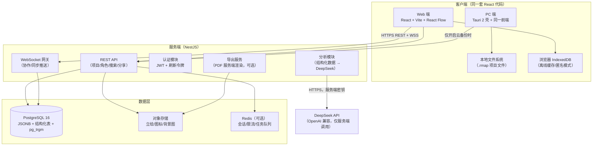
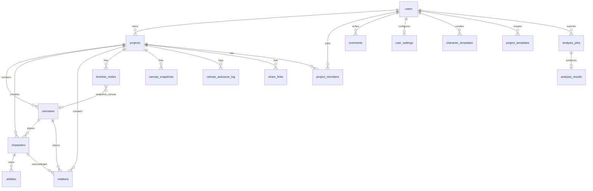
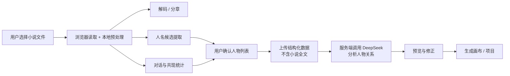

# 小说人物关系图工具 · 技术设计文档

| 项目 | 内容 |
| --- | --- |
| 文档版本 | v1.1 |
| 编写日期 | 2026-10-26（v1.1 更新于 2026-11-19） |
| 文档状态 | 评审稿 |
| 本次更新 | 关系箭头反向（R）、完整快捷键体系、自动保存/版本快照/崩溃恢复规则、AI 小说关系图提取设计 |
| 目标平台 | Web 端 + PC 桌面端（可执行文件） |
| 后端数据库 | PostgreSQL |

---

## 1. 项目概述

### 1.1 产品定位

本产品是一款用于展示小说人物关系的关系图工具，采用类思维导图的交互样式。用户以角色为节点、以关系为连线，可视化地梳理小说的人物网络。

### 1.2 设计目标

- **理清人物关系**：帮助尚未阅读该小说、但希望在阅读前掌握人物关系的用户，以及已经阅读但尚未理清人物关系的用户，快速建立清晰的人物关系认知
- **简洁**：上手成本低，核心操作（建角色、连线、标注关系）一步完成
- **便于操作**：完整的快捷键体系、批量操作、搜索过滤、时间轴等效率工具
- **可以传播**：支持导出图片/数据、生成只读分享链接、嵌入代码

### 1.3 交付策略

先做出可上线的 Web 版本，所有功能完成后，将同一套前端代码通过 Tauri 2 打包为可执行文件（PC 端）。

---

## 2. 技术栈总览

| 层级 | 技术选型 | 版本 | 选型理由 |
| --- | --- | --- | --- |
| 前端框架 | React + TypeScript | React 18 / TS 6.x | 生态成熟，类型安全，组件化适合画布类复杂 UI |
| 构建工具 | Vite | 8.x | 启动快、HMR 快，适配 Tauri 集成 |
| 状态管理 | Zustand | 5.x | 轻量、无样板代码，适合画布高频状态更新 |
| 画布引擎 | React Flow (@xyflow/react) | 12.x | 原生支持节点/连线/缩放/平移/小地图/多选/分组，自定义节点能力满足圆形/方形角色框需求 |
| 快捷键 | react-hotkeys-hook | 4.x | 声明式快捷键绑定，支持作用域与自定义映射 |
| UI 组件库 | Ant Design | 5.x | 中后台交互组件齐全（弹窗、表单、表格），加速侧边栏/设置/搜索面板开发 |
| 桌面端 | Tauri 2 | 2.x | 同一套前端代码打包为可执行文件，体积小（约 5-10MB）、内存占用低；通过 JS API 桥接本地文件系统 |
| 后端框架 | NestJS + TypeScript | 12.x | 模块化架构，REST + WebSocket 双通道原生支持，与前端同语言 |
| 数据库 | PostgreSQL | 16.x | 要求指定；JSONB 存画布序列化数据，pg_trgm 支持模糊搜索，行级安全/索引能力满足检索与权限需求 |
| 实时协作 | Yjs + y-protocols | 13.x | CRDT 算法，为第四版多人实时协作提供无冲突合并能力 |
| AI 服务 | DeepSeek API（OpenAI 兼容接口） | — | 小说人物关系结构化抽取；仅由后端代理调用，密钥存 `.env`（`DEEPSEEK_API_WEB` / `DEEPSEEK_API_PC`） |
| 文档解析（浏览器本地） | JSZip + fast-xml-parser（EPUB）、mammoth（DOCX） | — | 本地解析小说文件，减少全文上传；MVP 仅 TXT |
| 流式传输 | SSE（服务端流式响应） | — | 分块分析进度与 AI 流式输出（第二版） |
| 对象存储 | S3 兼容（MinIO/OSS/COS） | — | 存储角色立绘、能力图标、背景图等用户上传资源 |
| 缓存/队列（可选） | Redis | 7.x | 会话、限流、快照清理定时任务队列 |

### 2.1 关键选型说明

1. **React Flow 而非 Konva/ECharts Graph**：React Flow 在节点编辑器场景（类似思维导图/流程图）是事实标准，自带缩放、平移、框选、小地图、分组（父节点）、自定义节点与边，可大幅减少自研工作量；Konva 更底层，自定义能力强但开发成本高。
2. **Tauri 而非 Electron**：Tauri 2 打包体积约为 Electron 的 1/10~1/20，内存占用低，满足"打包成可执行文件"且对体积敏感的目标；前端代码与 Web 端 100% 复用，通过 `@tauri-apps/api` 的 fs/dialog 插件访问本地文件。
3. **PostgreSQL JSONB + 结构化双轨存储**：画布渲染状态（节点坐标、边路径）以 React Flow 序列化 JSON 存入 JSONB；角色、关系、能力等业务实体同步建结构化表，支撑搜索、过滤、统计与协作。
4. **Yjs 预埋**：第一至三版不做实时协作，但数据模型与存储层按"可合并的文档"设计，第四版引入 Yjs 时无需重构。
5. **AI 提取采用"本地预处理 + 服务端分析"混合架构**：小说全文在浏览器内完成解码、分章、人名候选与共现统计，仅上传结构化数据；服务端通过 DeepSeek（OpenAI 兼容）分析关系，密钥不进入前端。兼顾隐私、带宽成本与关系语义质量（见 5.21）。

---

## 3. 系统架构

### 3.1 总体架构图



### 3.2 前端架构（Web 与 PC 共用）

```
src/
├── components/
│   ├── canvas/            # 画布：CharacterNode、RelationEdge、Toolbar、MiniMap、TimelineBar
│   ├── analysis/          # 提取向导：上传、模板选择、人物确认、预览修正
│   ├── sidebar/           # 侧边栏：文件树、最近项目、快捷键表
│   ├── panels/            # 搜索面板、历史面板、图层面板、模板面板
│   ├── modals/            # 角色详情、能力编辑、冲突解决、分享设置
│   └── settings/          # 设置页
├── store/                 # Zustand：projectStore、canvasStore、timelineStore、uiStore、syncStore
├── core/
│   ├── storage/           # 存储适配层：CloudStorage（REST）/ LocalStorage（Tauri FS / IndexedDB）
│   ├── exporter/          # PNG/JPG/SVG/JSON/Markdown/PDF 导出
│   ├── importer/          # 文本/CSV/Excel/XMind 导入
│   ├── extractor/         # 小说本地预处理：解码、分章、人名候选、对话/共现统计
│   ├── history/           # 撤销/重做（命令栈）与历史面板
│   ├── sync/              # 自动保存调度、离线缓存、冲突检测
│   └── shortcuts/         # 键位映射与分发
└── api/                   # REST 客户端、WebSocket 客户端（预留协作）
```

**存储适配层（StorageAdapter）**是关键抽象：定义统一接口 `load/save/rename/delete/list/recent`，Web 端实现为 REST 云端实现，PC 端默认实现为 Tauri 本地文件实现、可选切换为云端实现（用户在设置中开启"上传到服务器"）。

### 3.3 后端架构（NestJS 模块）

| 模块 | 职责 |
| --- | --- |
| `AuthModule` | 注册/登录（含匿名会话）、JWT 签发与刷新、账户注销（级联删除数据，GDPR） |
| `ProjectsModule` | 项目 CRUD、最近列表、重命名、删除 |
| `CanvasModule` | 画布节点/边 JSONB 读写、乐观锁版本控制、自动保存接收 |
| `CharactersModule` | 角色/能力/关系结构化数据 CRUD（与画布 JSON 双向同步） |
| `SearchModule` | 角色/关系/能力/标签搜索与过滤（pg_trgm 模糊匹配） |
| `AnalysisModule` | 小说提取任务编排：接收本地结构化数据、代理调用 DeepSeek、结果过滤、配额扣减与临时数据 TTL 清理（SSE 进度为第二版，见 5.21） |
| `TimelineModule` | 时间轴节点、快照/差异模式数据管理 |
| `SnapshotsModule` | 版本快照创建/比较/恢复、保留策略定时清理（Cron） |
| `ShareModule` | 分享链接生成/校验（公开/私密/密码）、嵌入页数据下发 |
| `CommentsModule` | 评论、@提及、通知（第四版） |
| `CollabModule` | WebSocket 房间管理、Yjs 文档同步、在线状态（第四版） |
| `TemplatesModule` | 角色/关系/项目模板 |
| `FilesModule` | 立绘/图标/背景图上传，S3 对象存储 |

### 3.4 Web 与 PC 数据流差异

| 场景 | Web 端 | PC 端 |
| --- | --- | --- |
| 数据保存位置 | 云端 PostgreSQL（首次上传隐私提示时机待确认，见 5.16.11） | 本地 `.rmap` 文件（Tauri FS）；设置中可开启云备份。**PC 本地优先模式尚未实现，当前代码仍走云端自动保存** |
| 自动保存 | 每 3 分钟检查内容指纹，有变化才 PUT；手动保存 + `Ctrl/Cmd + S`；首次手动保存/首次退出走命名流程（5.16.4） | 目标为编辑防抖本地写盘 + 手动保存；开启云备份后沿用 Web 规则；快照策略另行设计 |
| 离线编辑 | IndexedDB 本地草稿（5.16.6），恢复网络且 dirty 时立即同步 | 天然支持（本地文件）；上线后自动同步云端 |
| 文件操作 | 文件选择器上传 `.rmap` / `.json` 并导入为新项目 | 规划支持系统原生文件对话框（`.rmap` / `.json`），尚未实现 |
| 匿名模式 | 无需注册，数据仅存 IndexedDB，清浏览器即删除 | 不适用（本地文件天然无需账户） |

---

## 4. 数据模型设计（PostgreSQL）

### 4.1 ER 关系总览



### 4.2 表结构明细

#### 4.2.1 users — 用户

| 字段 | 类型 | 约束 | 说明 |
| --- | --- | --- | --- |
| id | UUID | PK, 默认 gen_random_uuid() | 用户主键 |
| email | CITEXT | UNIQUE, 可空 | 邮箱（匿名用户为空） |
| password_hash | TEXT | 可空 | argon2id 哈希（匿名用户为空） |
| nickname | TEXT | NOT NULL | 昵称 |
| avatar_url | TEXT | 可空 | 头像地址 |
| is_anonymous | BOOLEAN | 默认 false | 匿名模式标记 |
| created_at / updated_at | TIMESTAMPTZ | 默认 now() | 时间戳 |
| deleted_at | TIMESTAMPTZ | 可空 | 软删除（注销后 7 天物理删除） |

#### 4.2.2 projects — 项目（文件）

| 字段 | 类型 | 约束 | 说明 |
| --- | --- | --- | --- |
| id | UUID | PK | 项目主键 |
| owner_id | UUID | FK → users, NOT NULL | 所有者 |
| name | TEXT | NOT NULL | 项目名（主界面与侧边栏展示） |
| description | TEXT | 可空 | 项目简介 |
| cover_image | TEXT | 可空 | 封面图（主界面卡片） |
| timeline_mode | TEXT | CHECK ('snapshot','diff')，默认 'snapshot' | 时间轴模式（项目级设置） |
| current_version | INT | 默认 1，已弃用 | 历史字段，不再作为乐观锁依据；版本以 `canvases.version`（revision）为准，后续迁移删除 |
| local_only | BOOLEAN | 默认 false | 仅本地存储标记（PC 端） |
| last_modified_at | TIMESTAMPTZ | 索引 | 最近修改时间（最近打开列表排序依据） |
| created_at / updated_at / deleted_at | TIMESTAMPTZ | — | 时间戳 |

#### 4.2.3 canvases — 画布

React Flow 渲染状态与项目设置的持久化载体。

| 字段 | 类型 | 约束 | 说明 |
| --- | --- | --- | --- |
| id | UUID | PK | 画布主键（时间轴快照模式中每个时间节点对应一张画布） |
| project_id | UUID | FK → projects, NOT NULL | 所属项目 |
| name | TEXT | 默认 '默认画布' | 画布名 |
| nodes | JSONB | NOT NULL, 默认 '[]' | React Flow 节点序列化数组（含角色节点/分组/标注/便签） |
| edges | JSONB | NOT NULL, 默认 '[]' | React Flow 边序列化数组（关系线及样式） |
| viewport | JSONB | 默认 '{"x":0,"y":0,"zoom":1}' | 视口状态（位置与缩放，跨会话保留） |
| settings | JSONB | 默认 '{}' | 画布设置：背景（颜色/图片/透明度）、能力图标开关、时间轴显示状态 |
| version | INT | 默认 1 | revision：服务端单调递增的乐观锁修订号；API 字段 `baseVersion` 语义等同于 revision |
| updated_at | TIMESTAMPTZ | 默认 now() | 更新时间 |

`settings` JSONB 结构：

```json
{
  "background": { "type": "color", "value": "#ffffff", "opacity": 1 },
  "abilityIconEnabled": false,
  "timelineVisible": true
}
```

#### 4.2.4 characters — 角色（结构化冗余）

角色同时存在于 `canvases.nodes`（渲染）与本表（业务检索），通过 `node_id` 关联。写入时由后端事务保证双侧一致。

| 字段 | 类型 | 约束 | 说明 |
| --- | --- | --- | --- |
| id | UUID | PK | 角色主键（与 node id 同源） |
| project_id | UUID | FK → projects | 所属项目 |
| canvas_id | UUID | FK → canvases | 所在画布（时间轴快照下每节点独立） |
| node_id | TEXT | NOT NULL | 对应 React Flow node id |
| shape | TEXT | CHECK ('circle','square')，默认 'circle' | 角色框形状（圆形/方形） |
| name | TEXT | NOT NULL | 姓名（必选） |
| gender | TEXT | NOT NULL | 性别（必选） |
| avatar_url | TEXT | 可空 | 角色立绘地址（可选，默认占位图） |
| faction | TEXT | 可空 | 阵营（可选，过滤维度） |
| tags | TEXT[] | 默认 '{}'，GIN 索引 | 标签（可选，搜索维度） |
| attributes | JSONB | 默认 '{}' | 自定义属性键值对（可选） |
| x / y | DOUBLE PRECISION | 可空 | 节点坐标冗余（供 SQL 空间过滤，渲染以 nodes JSONB 为准） |
| created_at / updated_at | TIMESTAMPTZ | — | 时间戳 |

#### 4.2.5 abilities — 能力（技能）

| 字段 | 类型 | 约束 | 说明 |
| --- | --- | --- | --- |
| id | UUID | PK | 能力主键 |
| character_id | UUID | FK → characters ON DELETE CASCADE | 所属角色 |
| name | TEXT | NOT NULL | 能力名称 |
| detail | TEXT | 可空 | 能力详细信息（仅编辑弹窗内可修改） |
| icon_url | TEXT | 可空 | 技能图标（为空时使用默认图标） |
| sort_order | INT | 默认 0 | 展示顺序 |
| created_at / updated_at | TIMESTAMPTZ | — | 时间戳 |

#### 4.2.6 relations — 关系

| 字段 | 类型 | 约束 | 说明 |
| --- | --- | --- | --- |
| id | UUID | PK | 关系主键（与 edge id 同源） |
| project_id | UUID | FK → projects | 所属项目 |
| canvas_id | UUID | FK → canvases | 所在画布 |
| edge_id | TEXT | NOT NULL | 对应 React Flow edge id |
| source_character_id | UUID | FK → characters | 起点角色 |
| target_character_id | UUID | FK → characters | 终点角色 |
| relation_type | TEXT | 可空 | 关系类型（朋友/敌人/师徒/恋人/父子/同事/自定义），显示在连线上 |
| label | TEXT | 可空 | 线上附加标注文本（与关系类型二选一，默认使用关系类型） |
| style | JSONB | 默认 '{}' | 样式：颜色、粗细、边框类型（实线/虚线/双线等） |

`source_character_id → target_character_id` 即箭头方向。界面按 `R` 反向箭头时交换两者（同时交换画布 edge 的 `source`/`target`），关系类型、标注与样式保持不变（见 5.2、5.8）。

#### 4.2.7 timeline_nodes — 时间轴节点

| 字段 | 类型 | 约束 | 说明 |
| --- | --- | --- | --- |
| id | UUID | PK | 时间节点主键 |
| project_id | UUID | FK → projects | 所属项目 |
| name | TEXT | NOT NULL | 节点名，默认"时间节点n"（n = 当前节点数 + 1），可重命名 |
| position | INT | NOT NULL | 时间轴上的顺序 |
| snapshot_canvas_id | UUID | FK → canvases, 可空 | 快照模式：复制出的画布 |
| base_canvas_id | UUID | FK → canvases, 可空 | 差异模式：基础画布引用 |
| delta | JSONB | 可空 | 差异模式：RFC 6902 JSON Patch 数组（相对基础画布的变化） |
| created_at | TIMESTAMPTZ | 默认 now() | 创建时间 |

#### 4.2.8 canvas_snapshots — 版本快照（手动 / 安全）

> `canvases` 行是当前工作副本；本表只保存用户显式创建的手动快照，以及恢复前由系统创建的安全快照。不保存项目级重复副本。

| 字段 | 类型 | 约束 | 说明 |
| --- | --- | --- | --- |
| id | UUID | PK | 快照主键 |
| project_id | UUID | FK → projects, NOT NULL | 所属项目 |
| name | TEXT | NOT NULL | 快照名（trim 后非空；允许重名，列表显示创建时间） |
| data | JSONB | NOT NULL | 归一化全文快照 `{ schemaVersion, nodes, edges }`；不含 viewport、selected、dragging、measured、width/height 等瞬态字段 |
| schema_version | INT | NOT NULL | 快照数据结构版本 |
| type | TEXT | CHECK ('manual','safety')，默认 'manual' | 手动快照 / 恢复前安全快照 |
| created_by | UUID | FK → users, 可空 | 创建人；安全快照可为空（系统创建） |
| created_at | TIMESTAMPTZ | 索引 | 创建时间 |
| deleted_at | TIMESTAMPTZ | 可空 | 软删除时间（建议保留 7 天） |
| size_bytes | INT | NOT NULL | 快照 JSON 字节数，用于列表展示与后续配额统计 |

索引：`(project_id, created_at DESC)`；安全快照额外按 `project_id, type, created_at DESC` 查询，系统只保留最近 3 个。

#### 4.2.9 share_links — 分享链接

| 字段 | 类型 | 约束 | 说明 |
| --- | --- | --- | --- |
| id | UUID | PK | 主键 |
| project_id | UUID | FK → projects | 被分享项目 |
| token | TEXT | UNIQUE, NOT NULL | 随机 256 位令牌（URL 中的只读凭证） |
| permission | TEXT | CHECK ('public','private','password') | 公开/私密/密码保护 |
| password_hash | TEXT | 可空 | permission = 'password' 时存 argon2id 哈希 |
| embed_allowed | BOOLEAN | 默认 false | 是否允许 iframe 嵌入 |
| expires_at | TIMESTAMPTZ | 可空 | 过期时间（空 = 永久） |
| created_by / created_at | — | — | 创建信息 |

#### 4.2.10 project_members — 协作成员（第四版）

| 字段 | 类型 | 约束 | 说明 |
| --- | --- | --- | --- |
| project_id | UUID | PK 组成, FK → projects | 项目 |
| user_id | UUID | PK 组成, FK → users | 成员 |
| role | TEXT | CHECK ('owner','editor','viewer') | 所有者/编辑者/查看者 |
| invited_at | TIMESTAMPTZ | — | 邀请时间 |

#### 4.2.11 comments — 评论（第四版）

| 字段 | 类型 | 约束 | 说明 |
| --- | --- | --- | --- |
| id | UUID | PK | 主键 |
| project_id | UUID | FK → projects | 所属项目 |
| target_type | TEXT | CHECK ('character','relation','canvas','annotation') | 评论挂载对象类型 |
| target_id | UUID | NOT NULL | 对象 id |
| user_id | UUID | FK → users | 评论人 |
| parent_id | UUID | 可空 | 父评论（回复） |
| content | TEXT | NOT NULL | 内容 |
| mentions | UUID[] | 默认 '{}' | @提及的用户 id |
| resolved | BOOLEAN | 默认 false | 已解决标记 |
| created_at / updated_at | TIMESTAMPTZ | — | 时间戳 |

#### 4.2.12 模板表（三张）

| 表 | 关键字段 | 说明 |
| --- | --- | --- |
| character_templates | id, owner_id(可空=系统预设), name, type CHECK ('protagonist','supporting','villain','extra','custom'), fields JSONB, is_system | 主角/配角/反派/路人预设属性字段；用户可另存自定义模板 |
| relation_templates | id, owner_id, name, relation_type, style JSONB, is_system | 朋友/敌人/师徒/恋人/父子/同事预设，含默认颜色与样式 |
| project_templates | id, owner_id, name, data JSONB, is_system | 空白项目、示例项目（"三国人物关系"）、用户项目另存为模板 |

#### 4.2.13 user_settings — 用户设置

| 字段 | 类型 | 约束 | 说明 |
| --- | --- | --- | --- |
| user_id | UUID | PK, FK → users | 用户 |
| settings | JSONB | 默认 '{}' | 个性化设置（键位映射、画布背景、能力图标开关、自动保存间隔、云备份开关） |
| updated_at | TIMESTAMPTZ | — | 更新时间 |

`settings` JSONB 结构：

```json
{
  "keybindings": { "save": "mod+s", "createCharacter": "mod+alt+enter", "toggleTimeline": "mod+alt+p" },
  "canvasBackground": { "type": "image", "url": "s3://...", "opacity": 0.8 },
  "abilityIconEnabled": false,
  "cloudBackupEnabled": false,
  "autosaveIntervalSeconds": 180
}
```

#### 4.2.14 analysis_jobs — 小说提取任务（v1.1 已实现）

| 字段 | 类型 | 约束 | 说明 |
| --- | --- | --- | --- |
| id | UUID | PK | 任务主键 |
| user_id | UUID | FK → users, NOT NULL | 提交用户 |
| status | TEXT | CHECK ('pending','preprocessing','awaiting_confirm','analyzing','completed','failed','deleted')，默认 'pending' | 任务状态 |
| template | TEXT | 默认 'default' | 模板标识（default/xuanhuan/wuxia/romance/detective/scifi/custom） |
| file_name | TEXT | NOT NULL | 原始文件名（仅元数据，不存储文件内容） |
| file_size | BIGINT | NOT NULL | 文件字节数（大小限制依据） |
| char_count | INT | 默认 0 | 浏览器本地统计的字符数 |
| keep_result | BOOLEAN | 默认 false | 用户是否勾选"保存分析结果以便后续编辑" |
| quota_date | DATE | 默认 CURRENT_DATE | 配额统计日期（每日重置） |
| structured_data | JSONB | 可空 | 浏览器本地提取的人物候选、共现线索与有限片段；分析完成或失败后清空，不保存小说全文 |
| error_message | TEXT | 可空 | 失败原因 |
| expires_at | TIMESTAMPTZ | 索引 | 过期时间：keep_result=true 时为 now()+30 天；否则保留 1 天仅用于配额统计与错误排查，结构化输入和结果不保留 |
| created_at / updated_at / deleted_at | TIMESTAMPTZ | — | 时间戳 |

#### 4.2.15 analysis_results — 小说提取结果（v1.1 已实现）

| 字段 | 类型 | 约束 | 说明 |
| --- | --- | --- | --- |
| job_id | UUID | PK, FK → analysis_jobs ON DELETE CASCADE | 对应任务 |
| characters | JSONB | NOT NULL, 默认 '[]' | 用户确认后的角色候选（姓名/性别/描述/别名） |
| relations | JSONB | NOT NULL, 默认 '[]' | AI 返回并经用户修正的关系（from/to/type/description/confidence） |
| corrections | JSONB | 默认 '{}' | 用户修正记录（便于复算与问题追踪） |
| model | TEXT | 可空 | 实际调用的模型标识 |
| token_usage | JSONB | 默认 '{}' | 输入/输出 token 统计（成本核算） |
| created_at | TIMESTAMPTZ | — | 创建时间 |
| expires_at | TIMESTAMPTZ | 索引 | 与任务一致的 30 天 TTL |

说明：两张表均不保存小说原文，只保存本地提取的结构化数据与 AI 结果；过期数据由 `AnalysisModule` 定时任务物理删除。

#### 4.2.16 canvas_autosave_log — 自动保存审计日志（可选，后续规划）

> 仅用于审计/时间线，不作为崩溃恢复依据；崩溃恢复由 5.16 的本地草稿负责。MVP 可以先不实现本表。

| 字段 | 类型 | 约束 | 说明 |
| --- | --- | --- | --- |
| id | UUID | PK | 日志主键 |
| project_id | UUID | FK → projects, NOT NULL | 所属项目 |
| from_revision | INT | NOT NULL | 保存前 revision |
| to_revision | INT | NOT NULL | 保存后 revision |
| diff | JSONB | NOT NULL | nodes/edges 按 id 处理的 diff；更新项存整项 |
| size_bytes | INT | NOT NULL | diff 字节数 |
| created_at | TIMESTAMPTZ | 索引 | 创建时间 |
| expires_at | TIMESTAMPTZ | 索引 | 过期时间（默认 24 小时） |

单条 diff 超过 10KB 标记 oversized 并跳过，不阻断保存；按条数（建议 96 条）和字节数双重封顶，由服务端定时清理。

### 4.3 核心 DDL

```sql
CREATE EXTENSION IF NOT EXISTS pg_trgm;
CREATE EXTENSION IF NOT EXISTS pgcrypto;

CREATE TABLE users (
    id              UUID PRIMARY KEY DEFAULT gen_random_uuid(),
    email           CITEXT UNIQUE,
    password_hash   TEXT,
    nickname        TEXT NOT NULL,
    avatar_url      TEXT,
    is_anonymous    BOOLEAN NOT NULL DEFAULT FALSE,
    created_at      TIMESTAMPTZ NOT NULL DEFAULT now(),
    updated_at      TIMESTAMPTZ NOT NULL DEFAULT now(),
    deleted_at      TIMESTAMPTZ
);

CREATE TABLE projects (
    id               UUID PRIMARY KEY DEFAULT gen_random_uuid(),
    owner_id         UUID NOT NULL REFERENCES users(id),
    name             TEXT NOT NULL,
    description      TEXT,
    cover_image      TEXT,
    timeline_mode    TEXT NOT NULL DEFAULT 'snapshot'
                     CHECK (timeline_mode IN ('snapshot','diff')),
    current_version  INTEGER NOT NULL DEFAULT 1, -- 已弃用：版本以 canvases.version（revision）为准
    local_only       BOOLEAN NOT NULL DEFAULT FALSE,
    last_modified_at TIMESTAMPTZ NOT NULL DEFAULT now(),
    created_at       TIMESTAMPTZ NOT NULL DEFAULT now(),
    updated_at       TIMESTAMPTZ NOT NULL DEFAULT now(),
    deleted_at       TIMESTAMPTZ
);
CREATE INDEX idx_projects_owner ON projects(owner_id) WHERE deleted_at IS NULL;
CREATE INDEX idx_projects_recent ON projects(owner_id, last_modified_at DESC) WHERE deleted_at IS NULL;

CREATE TABLE canvases (
    id          UUID PRIMARY KEY DEFAULT gen_random_uuid(),
    project_id  UUID NOT NULL REFERENCES projects(id) ON DELETE CASCADE,
    name        TEXT NOT NULL DEFAULT '默认画布',
    nodes       JSONB NOT NULL DEFAULT '[]',
    edges       JSONB NOT NULL DEFAULT '[]',
    viewport    JSONB NOT NULL DEFAULT '{"x":0,"y":0,"zoom":1}',
    settings    JSONB NOT NULL DEFAULT '{}',
    version     INTEGER NOT NULL DEFAULT 1, -- revision：乐观锁修订号
    updated_at  TIMESTAMPTZ NOT NULL DEFAULT now()
);
CREATE INDEX idx_canvases_project ON canvases(project_id);

CREATE TABLE characters (
    id          UUID PRIMARY KEY DEFAULT gen_random_uuid(),
    project_id  UUID NOT NULL REFERENCES projects(id) ON DELETE CASCADE,
    canvas_id   UUID NOT NULL REFERENCES canvases(id) ON DELETE CASCADE,
    node_id     TEXT NOT NULL,
    shape       TEXT NOT NULL DEFAULT 'circle' CHECK (shape IN ('circle','square')),
    name        TEXT NOT NULL,
    gender      TEXT NOT NULL,
    avatar_url  TEXT,
    faction     TEXT,
    tags        TEXT[] NOT NULL DEFAULT '{}',
    attributes  JSONB NOT NULL DEFAULT '{}',
    x           DOUBLE PRECISION,
    y           DOUBLE PRECISION,
    created_at  TIMESTAMPTZ NOT NULL DEFAULT now(),
    updated_at  TIMESTAMPTZ NOT NULL DEFAULT now()
);
CREATE INDEX idx_characters_project ON characters(project_id);
CREATE INDEX idx_characters_name_trgm ON characters USING gin (name gin_trgm_ops);
CREATE INDEX idx_characters_tags ON characters USING gin (tags);
CREATE INDEX idx_characters_gender ON characters(gender);
CREATE INDEX idx_characters_faction ON characters(faction);

CREATE TABLE abilities (
    id            UUID PRIMARY KEY DEFAULT gen_random_uuid(),
    character_id  UUID NOT NULL REFERENCES characters(id) ON DELETE CASCADE,
    name          TEXT NOT NULL,
    detail        TEXT,
    icon_url      TEXT,
    sort_order    INTEGER NOT NULL DEFAULT 0,
    created_at    TIMESTAMPTZ NOT NULL DEFAULT now(),
    updated_at    TIMESTAMPTZ NOT NULL DEFAULT now()
);
CREATE INDEX idx_abilities_name_trgm ON abilities USING gin (name gin_trgm_ops);

CREATE TABLE relations (
    id                   UUID PRIMARY KEY DEFAULT gen_random_uuid(),
    project_id           UUID NOT NULL REFERENCES projects(id) ON DELETE CASCADE,
    canvas_id            UUID NOT NULL REFERENCES canvases(id) ON DELETE CASCADE,
    edge_id              TEXT NOT NULL,
    source_character_id  UUID NOT NULL REFERENCES characters(id) ON DELETE CASCADE,
    target_character_id  UUID NOT NULL REFERENCES characters(id) ON DELETE CASCADE,
    relation_type        TEXT,
    label                TEXT,
    style                JSONB NOT NULL DEFAULT '{}',
    created_at           TIMESTAMPTZ NOT NULL DEFAULT now(),
    updated_at           TIMESTAMPTZ NOT NULL DEFAULT now()
);
CREATE INDEX idx_relations_project ON relations(project_id);
CREATE INDEX idx_relations_type_trgm ON relations USING gin (relation_type gin_trgm_ops);

CREATE TABLE timeline_nodes (
    id                  UUID PRIMARY KEY DEFAULT gen_random_uuid(),
    project_id          UUID NOT NULL REFERENCES projects(id) ON DELETE CASCADE,
    name                TEXT NOT NULL,
    position            INTEGER NOT NULL,
    snapshot_canvas_id  UUID REFERENCES canvases(id) ON DELETE CASCADE,
    base_canvas_id      UUID REFERENCES canvases(id) ON DELETE CASCADE,
    delta               JSONB,
    created_at          TIMESTAMPTZ NOT NULL DEFAULT now()
);
CREATE INDEX idx_timeline_project ON timeline_nodes(project_id, position);

CREATE TABLE canvas_snapshots (
    id              UUID PRIMARY KEY DEFAULT gen_random_uuid(),
    project_id      UUID NOT NULL REFERENCES projects(id) ON DELETE CASCADE,
    name            TEXT NOT NULL,
    data            JSONB NOT NULL,
    schema_version  INTEGER NOT NULL,
    type            TEXT NOT NULL DEFAULT 'manual' CHECK (type IN ('manual','safety')),
    created_by      UUID REFERENCES users(id),
    created_at      TIMESTAMPTZ NOT NULL DEFAULT now(),
    deleted_at      TIMESTAMPTZ,
    size_bytes      INTEGER NOT NULL
);
CREATE INDEX idx_canvas_snapshots_project ON canvas_snapshots(project_id, created_at DESC);
CREATE INDEX idx_canvas_snapshots_safety ON canvas_snapshots(project_id, type, created_at DESC)
    WHERE type = 'safety';

-- 可选，后续规划：自动保存审计日志，不作为崩溃恢复依据
CREATE TABLE canvas_autosave_log (
    id             UUID PRIMARY KEY DEFAULT gen_random_uuid(),
    project_id     UUID NOT NULL REFERENCES projects(id) ON DELETE CASCADE,
    from_revision  INTEGER NOT NULL,
    to_revision    INTEGER NOT NULL,
    diff           JSONB NOT NULL,
    size_bytes     INTEGER NOT NULL,
    created_at     TIMESTAMPTZ NOT NULL DEFAULT now(),
    expires_at     TIMESTAMPTZ NOT NULL
);
CREATE INDEX idx_canvas_autosave_log_project ON canvas_autosave_log(project_id, created_at DESC);
CREATE INDEX idx_canvas_autosave_log_expires ON canvas_autosave_log(expires_at);

CREATE TABLE share_links (
    id             UUID PRIMARY KEY DEFAULT gen_random_uuid(),
    project_id     UUID NOT NULL REFERENCES projects(id) ON DELETE CASCADE,
    token          TEXT NOT NULL UNIQUE,
    permission     TEXT NOT NULL DEFAULT 'public'
                   CHECK (permission IN ('public','private','password')),
    password_hash  TEXT,
    embed_allowed  BOOLEAN NOT NULL DEFAULT FALSE,
    expires_at     TIMESTAMPTZ,
    created_by     UUID REFERENCES users(id),
    created_at     TIMESTAMPTZ NOT NULL DEFAULT now()
);

CREATE TABLE project_members (
    project_id  UUID NOT NULL REFERENCES projects(id) ON DELETE CASCADE,
    user_id     UUID NOT NULL REFERENCES users(id),
    role        TEXT NOT NULL DEFAULT 'viewer'
                CHECK (role IN ('owner','editor','viewer')),
    invited_at  TIMESTAMPTZ NOT NULL DEFAULT now(),
    PRIMARY KEY (project_id, user_id)
);

CREATE TABLE comments (
    id          UUID PRIMARY KEY DEFAULT gen_random_uuid(),
    project_id  UUID NOT NULL REFERENCES projects(id) ON DELETE CASCADE,
    target_type TEXT NOT NULL CHECK (target_type IN ('character','relation','canvas','annotation')),
    target_id   UUID NOT NULL,
    user_id     UUID NOT NULL REFERENCES users(id),
    parent_id   UUID,
    content     TEXT NOT NULL,
    mentions    UUID[] NOT NULL DEFAULT '{}',
    resolved    BOOLEAN NOT NULL DEFAULT FALSE,
    created_at  TIMESTAMPTZ NOT NULL DEFAULT now(),
    updated_at  TIMESTAMPTZ NOT NULL DEFAULT now()
);

CREATE TABLE user_settings (
    user_id     UUID PRIMARY KEY REFERENCES users(id) ON DELETE CASCADE,
    settings    JSONB NOT NULL DEFAULT '{}',
    updated_at  TIMESTAMPTZ NOT NULL DEFAULT now()
);

CREATE TABLE character_templates (
    id         UUID PRIMARY KEY DEFAULT gen_random_uuid(),
    owner_id   UUID REFERENCES users(id),
    name       TEXT NOT NULL,
    type       TEXT NOT NULL CHECK (type IN ('protagonist','supporting','villain','extra','custom')),
    fields     JSONB NOT NULL DEFAULT '{}',
    is_system  BOOLEAN NOT NULL DEFAULT FALSE
);

CREATE TABLE relation_templates (
    id            UUID PRIMARY KEY DEFAULT gen_random_uuid(),
    owner_id      UUID REFERENCES users(id),
    name          TEXT NOT NULL,
    relation_type TEXT,
    style         JSONB NOT NULL DEFAULT '{}',
    is_system     BOOLEAN NOT NULL DEFAULT FALSE
);

CREATE TABLE project_templates (
    id         UUID PRIMARY KEY DEFAULT gen_random_uuid(),
    owner_id   UUID REFERENCES users(id),
    name       TEXT NOT NULL,
    data       JSONB NOT NULL,
    is_system  BOOLEAN NOT NULL DEFAULT FALSE,
    created_at TIMESTAMPTZ NOT NULL DEFAULT now()
);

CREATE TABLE analysis_jobs (
    id             UUID PRIMARY KEY DEFAULT gen_random_uuid(),
    user_id        UUID NOT NULL REFERENCES users(id) ON DELETE CASCADE,
    status         TEXT NOT NULL DEFAULT 'pending'
                   CHECK (status IN ('pending','preprocessing','awaiting_confirm','analyzing','completed','failed','deleted')),
    template       TEXT NOT NULL DEFAULT 'default',
    file_name      TEXT NOT NULL,
    file_size      BIGINT NOT NULL,
    char_count     INTEGER NOT NULL DEFAULT 0,
    keep_result    BOOLEAN NOT NULL DEFAULT FALSE,
    quota_date     DATE NOT NULL DEFAULT CURRENT_DATE,
    structured_data JSONB,
    error_message  TEXT,
    expires_at     TIMESTAMPTZ,
    created_at     TIMESTAMPTZ NOT NULL DEFAULT now(),
    updated_at     TIMESTAMPTZ NOT NULL DEFAULT now(),
    deleted_at     TIMESTAMPTZ
);
CREATE INDEX idx_analysis_jobs_user_day ON analysis_jobs(user_id, quota_date);
CREATE INDEX idx_analysis_jobs_expires ON analysis_jobs(expires_at);

CREATE TABLE analysis_results (
    job_id       UUID PRIMARY KEY REFERENCES analysis_jobs(id) ON DELETE CASCADE,
    characters   JSONB NOT NULL DEFAULT '[]',
    relations    JSONB NOT NULL DEFAULT '[]',
    corrections  JSONB NOT NULL DEFAULT '{}',
    model        TEXT,
    token_usage  JSONB NOT NULL DEFAULT '{}',
    created_at   TIMESTAMPTZ NOT NULL DEFAULT now(),
    expires_at   TIMESTAMPTZ
);
CREATE INDEX idx_analysis_results_expires ON analysis_results(expires_at);
```

### 4.4 PC 端本地文件格式（.rmap）

> 实现状态：PC 本地优先模式尚未实现，当前代码仍走云端自动保存；本节为设计目标。PC 打开文件规划同时支持 `.rmap` 与 `.json`（兼容当前导出的 CanvasState 与项目 JSON），快照/自动保存策略另行设计。

PC 端默认不依赖数据库，项目保存为单个 `.rmap` 文件（JSON 格式，UTF-8）：

```json
{
  "format": "rmap",
  "version": 1,
  "project": { "name": "示例项目", "timelineMode": "snapshot" },
  "canvases": [
    {
      "id": "c1",
      "name": "默认画布",
      "nodes": [],
      "edges": [],
      "viewport": { "x": 0, "y": 0, "zoom": 1 },
      "settings": {}
    }
  ],
  "characters": [],
  "relations": [],
  "abilities": [],
  "timeline": [],
  "assets": { "<assetId>": "data:image/png;base64,..." }
}
```

说明：图片资源默认以 Base64 内嵌进 `assets`（保证单文件可传播）；文件超过阈值（如 20MB）时，PC 端改为侧车目录 `项目名.assets/` 存放原始图片并在 JSON 中引用相对路径。云端备份时 JSONB 结构与 4.2 表结构一一映射。

---

## 5. 核心模块技术设计

### 5.1 主界面与侧边栏

**主界面**（图片 1：main_interface）

- 布局：左侧侧边栏（可折叠）+ 右侧内容区。
- 侧边栏顶部为"新建文件"、"打开文件"两个入口：
  - Web 端：新建 → 创建项目并进入工作区；打开 → 文件选择器上传 `.rmap`/`.json` 或从云端项目列表选择。
  - PC 端：通过 Tauri dialog 插件调用系统原生文件对话框，规划支持 `.rmap` / `.json`；新建走系统"另存为"流程确定路径。**PC 本地优先模式尚未实现，当前代码仍走云端自动保存。**
- 内容区为**最近打开的项目**列表（卡片/表格），每条显示：项目名、最近修改时间（`projects.last_modified_at`）。PC 端本地模式下从本地目录扫描 `.rmap` 文件，将文件 mtime 作为最近修改时间。
- 侧边栏文件功能：打开编辑、重命名、保存到本地、下载到本地（Web 端）、删除（二次确认）、展开/收起按钮（CSS 宽度过渡，状态持久化到 `user_settings`）、快捷键表入口（弹窗列出 5.8 全部快捷键）。
- **项目重命名与删除**：首页最近项目列表与工作区侧边栏均可操作；删除二次确认，不要求输入项目名。删除当前正在编辑的项目后，优先进入最近项目列表中的下一个项目；没有剩余项目时自动创建空白项目并进入。删除非当前项目不打断当前编辑。
- **Web 打开文件导入**：选择 `.rmap` / `.json` 后归一化 label，创建新项目并保存画布；不覆盖当前项目。PC 端同类能力后续实现。

### 5.2 画布工作区（React Flow）

**组件结构**

- `<CanvasEditor>`：React Flow 根组件，管理 nodes/edges/viewport 状态（Zustand `canvasStore`）。
- `<CharacterNode>`：自定义节点，圆形（默认）或方形，`borderRadius` 依据 `shape` 字段切换；选中态/悬浮态/搜索命中高亮态三种视觉状态。
- `<RelationEdge>`：自定义边，支持箭头（`markerEnd`）、矩形/圆形端点装饰、线上 label 标注。
- `<CanvasToolbar>`：顶部工具栏。

**核心交互实现**

| 需求 | 实现方案 |
| --- | --- |
| 创建角色（圆形/方形） | 工具栏或 `Ctrl/Cmd + Alt + Enter` 创建；优先按当前视口与缩放计算可视世界区域，网格寻找不与现有节点重叠的空位；视口内放不下时回退随机位置，同时写 `characters` 表 |
| 新建工作区自动生成空角色 | 项目初始化时写入一个空角色节点，节点内显示提示文案"Ctrl/Cmd + Alt + 回车：创建新角色"（占位符样式，填写姓名后消失） |
| 悬浮显示角色详情 | `onNodeMouseEnter/Move/Leave` 控制 Tooltip（Portal 渲染），内容从 `characters` 读取；移开即销毁。详情面板显示：立绘（无则默认占位图）、姓名、性别、能力列表、属性、阵营 |
| 连接角色 | 工具栏切换模式（箭头/矩形/圆形线条样式），拖拽节点 handle 到目标节点生成 edge，弹出关系标注输入框（关系类型，显示在连线上） |
| 修改形状样式 | 选中节点/边后右侧属性面板：颜色（调色板）、粗细（1-8px 滑杆）、边框类型（实线/虚线/点线/双线，对应 SVG `strokeDasharray`） |
| 反向关系箭头 | 选中关系线后按 `R`（或属性面板"反向"按钮）：交换 edge 的 `source`/`target` 与 `sourceHandle`/`targetHandle`，关系类型、标注、颜色、粗细保持不变；同步交换 `relations` 表起点/终点，操作进入撤销栈（见 5.8） |
| 批量选择 | React Flow 原生框选（`selectionOnDrag`）、`Ctrl/Cmd + 点击` 多选、`Ctrl/Cmd + A` 全选、工具栏"选择同类型对象"（按 shape/关系类型过滤后加入选区） |
| 平移画布 | 拖动空白处 / 空格+拖动（自定义空格按下临时开启 `panOnDrag`） |

**性能目标**：单画布 500 节点内保持 60fps；超过时对节点渲染做虚拟化（仅渲染视口内节点，React Flow `onlyRenderVisibleElements`）。

### 5.3 角色详细信息（编辑弹窗）

- 表单字段：立绘（上传，未上传显示默认占位属性）、姓名（必填）、性别（必填）、能力列表（可增删改，见 5.4）、属性（键值对动态表单）、阵营、标签。
- 校验：姓名、性别必填，其余可空；前端 antd Form 校验 + 后端 DTO class-validator 双重校验。
- 保存：更新 `characters` 表与画布节点 `data`（事务内同步）。
- 性别控件：可搜索/可输入下拉，固定选项顺序为 **男 → 女 → 自定义预设 → 未知**，“未知”始终在最后并作为新角色默认值；自定义输入上限 20 字。
- 自定义性别预设（v1.1）：仅在用户显式点击“保存为预设”时收录；按账号存于 localStorage，key 为 `rmap.customGenders.{userId}`，同一账号在当前浏览器跨项目可用，不跨设备同步。最多保存 7 个，性别字段下方以可关闭标签展示，达到上限时提示先删除；删除预设不修改已保存角色的性别值。自定义项插入“未知”之前。
- 自定义性别预设 v2 规划：迁移到账号云端用户设置（`user_settings` 或 `users.settings` JSONB）实现跨设备同步；迁移时合并本地与云端数据，去重后最多保留 7 个。

### 5.4 能力详细信息（一行布局与响应式）

能力项在一行内包含四个 box：**图标 | 技能名 | 感叹号 icon | 编辑按钮**，边界关系规则：

| 交互 | 行为 |
| --- | --- |
| 默认 | 显示"图标 + 技能名"；图标未开启时隐藏图标位 |
| 悬浮感叹号 | Popover 显示能力详细信息（只读，不进入编辑态） |
| 点击编辑按钮 | 打开编辑弹窗（唯一可修改能力名称与详细信息的入口） |
| 长技能名 | CSS `text-overflow: ellipsis` 截断，悬浮显示完整名称（Tooltip） |
| 宽屏 | 一行显示全部四元素 |
| 窄屏 | 编辑按钮固定到行右侧 |
| 小屏 | 编辑按钮收进悬浮菜单（三个点按钮展开） |

- 能力图标：设置中开启"为能力添加图标"（默认关闭）后，所有技能显示图标位；未上传时显示内置默认图标；图标显示在技能名左侧。
- 响应式实现：CSS Grid 布局 + 媒体查询断点（`lg/md/sm`），与需求三档对应。

### 5.5 设置（个性化）

| 设置项 | 存储 | 实现说明 |
| --- | --- | --- |
| 画布背景：颜色/图片 + 透明度 | `canvases.settings.background`（持久化） | 颜色为纯色填充；图片走对象存储/本地资源；透明度作用于背景层（CSS opacity），不影响节点 |
| 时间轴显示 | `canvases.settings.timelineVisible` | 默认开启，以 70% 透明度渲染在工作区上方、工具栏下方（`TimelineBar` 组件，`opacity: 0.7`） |
| 能力图标开关 | `user_settings.settings.abilityIconEnabled` | 默认关闭；开启后所有技能可添加图标（见 5.4） |

PC 端设置保存在本地（`user_settings` 不适用时存于应用配置目录 `app_config.json`）；开启云备份后同步到服务端。

### 5.6 时间轴（章节轴）

**定位**：表达小说时间维度。时间轴横条置于工作区上方、工具栏下方，默认 70% 透明度。

**基础行为**

| 需求 | 实现 |
| --- | --- |
| 创建时间节点 | 点击时间轴"+"按钮：复制当前画布到新画布（快照模式）或记录当前差异（差异模式），新节点追加到末尾 |
| 切换时间节点 | 点击节点按钮切换画布（加载对应画布数据，替换 `canvasStore`） |
| 节点重命名 | 双击/右键重命名；默认名"时间节点n"，n = 当前节点数 + 1 |
| 悬浮提示 | Tooltip 显示当前节点标题 |
| 显示/隐藏 | `Ctrl/Cmd + Alt + P` 切换时间轴条显示 |

**两种模式（设置中选择，选择 UI 中展示优缺点提示）**

| 模式 | 存储 | 优点 | 缺点 | 适用场景 |
| --- | --- | --- | --- | --- |
| 快照模式 | 每个时间节点整表复制一份 `canvases` 行（`timeline_nodes.snapshot_canvas_id`） | 每个时间点独立，互不影响 | 数据冗余，难以批量修改 | 时间节点少（< 5 个）、变化大 |
| 差异模式 | 基础画布 + 每个节点的 RFC 6902 JSON Patch（`timeline_nodes.delta`） | 数据量小，批量修改方便 | 实现复杂，需要变更追踪系统 | 节点多、变化小 |

**差异模式技术方案**：

1. 以首个时间节点画布为 `base_canvas`。
2. 每次切换节点时对当前画布生成 JSON Patch（使用 `fast-json-patch` 库 diff 节点/边数组），存入对应 `timeline_nodes.delta`。
3. 切换目标节点时：`目标画布 = base + applyPatches(该节点 delta)`，结果加载进 `canvasStore`。
4. 变更追踪：节点/边的新增、删除、修改统一经由 `canvasStore` 的 action 层记录 diff 源（类似撤销栈的逆操作流），保证 patch 生成准确性。
5. 示例：第 3 章新增角色 B（add 操作）、第 5 章删除角色 A（remove 操作），切换即"基础画布 + 应用差异"。

**模式选择 UI**：设置弹窗内两个单选项，每项附优点/缺点/适用场景说明文案（即上表内容）。

### 5.7 搜索与过滤

**搜索（Ctrl/Cmd + F 打开搜索面板）**

| 维度 | 实现 |
| --- | --- |
| 按角色名 | `characters.name ILIKE '%q%'`（gin_trgm 索引） |
| 按关系类型 | `relations.relation_type ILIKE '%q%'`（如"找出所有师徒关系"） |
| 按能力 | `abilities.name ILIKE '%q%'` JOIN characters（如"找出所有会魔法的角色"） |
| 按标签 | `tags @> ARRAY[q]` 或标签模糊匹配（GIN 索引） |
| 模糊搜索 | 全部走 pg_trgm 相似度 + `ILIKE`，支持拼写容错（`similarity() > 0.3` 阈值） |
| 高亮匹配结果 | 命中节点在画布中加高亮描边 + 波纹动画，非命中节点降透明度；结果列表侧面板可点击跳转（`setCenter` 定位） |

**过滤**

| 维度 | 实现 |
| --- | --- |
| 按性别 | `characters.gender` 下拉多选 |
| 按阵营 | `characters.faction` 下拉多选 |
| 按时间节点 | 只显示该节点画布中存在的角色（快照模式：按 `canvas_id`；差异模式：按 patch 计算成员集合） |
| 关系线类型 | 前端按 `relations.relation_type` 隐藏/显示对应 edge |

搜索与过滤组合执行：过滤在服务端 SQL 完成，命中集返回前端后驱动画布高亮与隐藏。

### 5.8 快捷键系统

**设计**：`react-hotkeys-hook` + 自定义键位映射表。所有快捷键按作用域注册在 `KeymapProvider`，可覆盖项从 `user_settings.settings.keybindings` 读取。**仅 PC 端支持自定义快捷键**（设置 → 快捷键，录键即替换）；Web 端使用固定默认键位。冲突检测：同一作用域内重复绑定给出警告并拒绝保存。

**通用规则**

- `mod` 键自动映射 macOS `Cmd` / Windows/Linux `Ctrl`（`platform` 检测）。
- 需阻止浏览器默认行为的快捷键：`mod+s`、`mod+o`、`mod+f`、`mod+a`、`mod+加号/减号` 等。
- `Ctrl/Cmd + -` 可能被浏览器占用：实现时优先尝试绑定；若浏览器仍拦截，使用 `Ctrl/Cmd + Shift + -` 作为缩小备选，工具栏缩放按钮始终保留。
- 输入框/文本域聚焦时不触发画布级快捷键；`Escape` 优先关闭当前弹窗，其次取消选中。
- 上下文快捷键仅在该类对象被选中时生效：`R`/`L`/`Shift+L` 仅对关系线，`F2`/`Enter` 根据选中对象打开角色或关系详情。
- 界面按钮文案「恢复」对应通用概念"重做"（redo），快捷键与行为不变。

**全局快捷键（任何时候可用）**

| 快捷键 | 功能 | 说明 |
| --- | --- | --- |
| `Ctrl/Cmd + S` | 保存工作区 | 手动保存当前项目 |
| `Ctrl/Cmd + Shift + S` | 创建版本快照 | 保存当前内容并生成手动快照（见 5.16.5） |
| `Ctrl/Cmd + Alt + S` | 另存为 | 复制为新项目，不复制快照 |
| `Ctrl/Cmd + O` | 打开项目 | 打开文件选择器 |
| `Ctrl/Cmd + Z` | 撤销 | 撤销上一步操作 |
| `Ctrl/Cmd + Shift + Z` | 恢复（重做） | 恢复已撤销的操作 |
| `Ctrl/Cmd + F` | 搜索人物 | 打开搜索框 |
| `Ctrl/Cmd + Alt + P` | 显示/隐藏时间轴 | 切换时间轴可见性 |
| `Ctrl/Cmd + Alt + Enter` | 创建新角色 | 在画布中央创建角色 |
| `Escape` | 取消选中/关闭弹窗 | 取消当前操作 |
| `Ctrl/Cmd + /` 或 `?` | 显示快捷键帮助 | 打开按作用域分组的快捷键面板 |

**画布操作**

| 快捷键 | 功能 | 说明 |
| --- | --- | --- |
| 拖动空白处 | 平移画布 | 鼠标拖动移动视图 |
| `Space + 拖动` | 平移画布（备选） | 按住空格键拖动 |
| `Ctrl/Cmd + 滚轮` | 缩放画布 | 放大或缩小视图 |
| `Ctrl/Cmd + +` | 放大 | 放大画布 |
| `Ctrl/Cmd + -` | 缩小 | 缩小画布；若浏览器占用则使用Ctrl/Cmd + Shift + - |
| `Ctrl/Cmd + 0` | 重置缩放 | 恢复到 100% |
| `Ctrl/Cmd + 1` | 适应画布 | 缩放到显示所有内容 |
| `Ctrl/Cmd + 2` | 适应选中对象 | 缩放到选中对象 |

**对象选择与编辑**

| 快捷键 | 功能 | 说明 |
| --- | --- | --- |
| 点击 | 选中对象 | 选中角色或关系线 |
| `Ctrl/Cmd + 点击` | 多选 | 添加到选区 |
| `Shift + 点击` | 范围选择 | 选择两点之间的对象 |
| `Ctrl/Cmd + A` | 全选 | 选中所有对象 |
| `Ctrl/Cmd + D` | 取消选择 | 清空选区 |
| `Delete` | 删除选中对象 | 删除角色或关系 |
| `Backspace` | 删除选中对象（备选） | Mac 用户习惯 |
| `Ctrl/Cmd + C` | 复制 | 复制选中对象 |
| `Ctrl/Cmd + V` | 粘贴 | 粘贴对象 |
| `Ctrl/Cmd + X` | 剪切 | 剪切对象 |

**角色操作（选中角色时）**

| 快捷键 | 功能 | 说明 |
| --- | --- | --- |
| `F2` | 编辑角色详情 | 打开详细信息编辑面板 |
| `Enter` | 编辑角色名称 | 进入名称编辑模式 |
| 双击 | 编辑角色名称（备选） | 鼠标操作 |
| `Ctrl/Cmd + E` | 快速编辑 | 打开简化编辑界面 |

**关系操作（选中关系线时）**

| 快捷键 | 功能 | 说明 |
| --- | --- | --- |
| `R` | 反向箭头 | 将 A→B 变为 B→A，同步交换结构化关系表的起点/终点 |
| `L` | 切换直线/曲线 | 切换关系线样式 |
| `Shift + L` | 切换线型 | 实线/虚线/点线 |
| `F2` | 编辑关系详情 | 编辑关系类型和描述 |

`R` 的实现：交换 edge 的 `source`/`target`（若存在 `sourceHandle`/`targetHandle` 一并交换），关系类型、标注、颜色、粗细、箭头样式保持不动，并写入撤销栈；同时同步 `relations.source_character_id` 与 `target_character_id`。

**批量操作（多选时）**

| 快捷键 | 功能 | 说明 |
| --- | --- | --- |
| `Ctrl/Cmd + G` | 成组 | 将选中对象编组 |
| `Ctrl/Cmd + Shift + G` | 取消成组 | 解散组 |
| `Ctrl/Cmd + ]` | 上移一层 | 调整层级 |
| `Ctrl/Cmd + [` | 下移一层 | 调整层级 |
| `Ctrl/Cmd + Shift + ]` | 置于顶层 | 移到最上层 |
| `Ctrl/Cmd + Shift + [` | 置于底层 | 移到最下层 |

**对齐与分布（多选时）**

| 快捷键 | 功能 | 说明 |
| --- | --- | --- |
| `Ctrl/Cmd + Alt + L` | 左对齐 | 对齐到最左侧 |
| `Ctrl/Cmd + Alt + R` | 右对齐 | 对齐到最右侧 |
| `Ctrl/Cmd + Alt + T` | 顶部对齐 | 对齐到最上方 |
| `Ctrl/Cmd + Alt + B` | 底部对齐 | 对齐到最下方 |
| `Ctrl/Cmd + Alt + H` | 水平居中对齐 | 水平方向居中 |
| `Ctrl/Cmd + Alt + V` | 垂直居中对齐 | 垂直方向居中 |

**视图与界面**

| 快捷键 | 功能 | 说明 |
| --- | --- | --- |
| `Ctrl/Cmd + \`（反斜杠） | 显示/隐藏侧边栏 | 切换侧边栏 |
| `Ctrl/Cmd + .` | 打开设置 | 打开设置面板 |
| `F11` | 全屏模式 | 进入/退出全屏 |
| `Alt + 1` | 切换到编辑模式 | 默认编辑模式 |
| `Alt + 2` | 切换到预览模式 | 只读预览 |
| `Alt + 3` | 切换到演示模式 | 全屏演示 |

> 快捷键与功能模块的对应实现见 5.9（导航缩放）、5.10（撤销/恢复与版本快照）、5.11（批量与对齐）、5.12（分组与图层）、5.16（保存/快照）。

### 5.9 画布导航与缩放

| 功能 | 实现 |
| --- | --- |
| 缩放滑块 10%–500% | 工具栏 Slider 绑定 `zoomIn/zoomOut`，边界 0.1–5.0 |
| 快捷键缩放 | `Ctrl/Cmd + 加号` 放大、`Ctrl/Cmd + 减号` 缩小（步进 0.1）；`Ctrl/Cmd + -` 被浏览器占用时使用 `Ctrl/Cmd + Shift + -` |
| 滚轮缩放 | `Ctrl + 滚轮`（React Flow `zoomOnScroll` 默认行为 + Ctrl 修饰） |
| 缩放到适应画布 | `fitView`（计算全部节点包围盒），快捷键 `Ctrl/Cmd + 1` |
| 缩放到选中对象 | `fitView({ nodes: selectedNodes })`，快捷键 `Ctrl/Cmd + 2` |
| 实际尺寸 | `setViewport({ zoom: 1 })`，快捷键 `Ctrl/Cmd + 0` |
| 小地图/鸟瞰图 | React Flow `<MiniMap>`，右下角；当前可视区域自动高亮；点击小地图快速跳转（原生支持）；可折叠（面板按钮，状态持久化） |

### 5.10 撤销/重做与版本管理

**撤销/重做**（界面按钮文案：撤销 / 恢复）

- 采用**命令模式 + 快照栈**：每个可撤销操作（增删改节点/边/样式、箭头反向、批量样式修改）封装为 command（含 `execute/undo`），栈容量 100；简单操作用状态快照（Zustand `temporal` 中间件）。
- **撤销历史面板**：侧边面板列出操作历史（操作名 + 时间戳），点击任意条目跳转到该历史状态（将栈截断到该位置执行 undo）。

**版本快照**（完整规则见 5.16.5）

| 需求 | 实现 |
| --- | --- |
| 手动快照 | "创建快照"按钮或 `Ctrl/Cmd + Shift + S`，命名后存 `canvas_snapshots` 表；创建快照 = 保存当前内容 + 生成全量快照，同一事务完成 |
| 安全快照 | 恢复前自动创建，`type = safety`，系统保留最近 3 个，不占用户快照配额 |
| 恢复到历史版本 | 选定快照 → 二次确认 → 校验 baseRevision → 自动创建安全快照 → 替换工作副本 → revision+1；恢复前状态压入撤销栈 |
| 版本对比 | 后续规划（V3）：基于手动快照的双视图/diff；不作为崩溃恢复依据 |
| 清理 | 后台清理永不自动删除手动快照；项目软删除时级联软删快照，7 天后物理清理 |

> 自动快照 Cron 与按时间保留策略不再采用；崩溃恢复由 5.16.6 的本地草稿负责，服务端 diff 仅作为可选审计日志。

### 5.11 批量操作

- 批量选择：框选、`Ctrl/Cmd + 点击`、`Ctrl/Cmd + A`、按同类型选择（工具栏下拉：同形状/同阵营/同关系类型）。
- 批量编辑：属性面板作用于多选集合——批量修改颜色（统一色值）、批量修改大小（缩放节点尺寸）、批量删除、批量移动（拖动选区整体位移）、批量设置属性（如统一阵营/标签，弹窗表单应用到所有选中角色）。
- 对齐与分布：工具栏对齐按钮组——左/右/居中对齐、顶部/底部/垂直居中、水平/垂直分布、等距分布；实现为对选中节点包围盒的计算与坐标重排。快捷键见 5.8 的"对齐与分布"一节。

### 5.12 图层与分组

**图层系统**（预设层：背景层、角色层、关系层、标注层）

| 能力 | 实现 |
| --- | --- |
| 创建图层 | 图层面板可新建自定义图层 |
| 显示/隐藏 | 图层面板眼睛开关：前端按 `node.data.layer` 过滤渲染（隐藏层节点/边不渲染且不可选） |
| 锁定图层 | 锁图标：该层对象禁止拖动/编辑/删除（`nodesDraggable` 按层判定） |
| 调整顺序 | 图层面板拖拽排序：层序映射为渲染 z-index（`node.zIndex = layer.order * 100`） |
| 图层透明度 | 每层 opacity 滑块（作用于该层所有节点/边样式） |

**分组功能**

- 采用 React Flow 父节点（group node）实现："创建分组"生成一个容器节点（如"正派阵营"），成员节点设置 `parentId`。
- 折叠/展开：折叠时组节点缩为小卡片（成员 `extent: 'parent'` 隐藏），展开恢复。
- 整体移动：拖动组节点即带动全部成员（React Flow 原生父子联动）。
- 分组样式：边框、背景色在属性面板设置（组节点 `style`）。
- 分组与层级快捷操作：`Ctrl/Cmd + G` / `Ctrl/Cmd + Shift + G` 成组/解组，`Ctrl/Cmd + ]` / `[` 上移/下移一层，`Ctrl/Cmd + Shift + ]` / `[` 置顶/置底（见 5.8）。

### 5.13 注释与标注

| 类型 | 实现 |
| --- | --- |
| 文本标注 | 自定义 annotation 节点（文本框），内容支持富文本（加粗/颜色/字号，`contentEditable` + 工具栏），用于解释特定关系或情节 |
| 便签 | 角色节点上的便签徽标（StickyNote 子组件），点击展开记录创作想法/待办；全局开关隐藏/显示所有便签 |
| 标记 | 角色节点角标：星标、旗帜（重要角色）；"待完善"提醒（橙色角标，角色信息不完整时自动提示）；冲突关系高亮（同步冲突时红色描边） |

### 5.14 导出

| 格式 | 技术方案 |
| --- | --- |
| PNG / JPG | `html-to-image` 对画布容器截图（`toPng`/`toJpeg`）；导出范围可选：全部画布（fit 包围盒）/选中区域/可视区域；分辨率可自定义（`pixelRatio` 倍率，如 1x/2x/3x） |
| SVG | MVP 用 `html-to-image` 的 `toSvg`（DOM 转 SVG foreignObject）；后期优化为自定义 SVG 序列化器（节点为简单圆形/方形，可直接生成原生 SVG 保证清晰度与可编辑性） |
| JSON | 导出项目完整数据（4.4 的 `.rmap` 结构），用于备份与跨端迁移 |
| Markdown | 模板化生成：项目名 → 角色列表（姓名/性别/阵营/能力表格）→ 关系列表 → 时间轴节点摘要 |
| PDF | 前端 `jsPDF` 直接生成（MVP）；服务端 Puppeteer 渲染（可选，导出大型项目时保证排版一致） |

### 5.15 数据导入

| 来源 | 技术方案 |
| --- | --- |
| 文本导入 | 粘贴角色列表（每行一个名字，自动建角色）；解析关系文本：正则匹配 `A - 关系类型 - B`（如"张三 - 朋友 - 李四"），自动建关系边；解析失败的行在预览中标记供用户修正 |
| 小说文件（AI 提取） | 用户上传 `.txt` 等小说文件，浏览器本地预处理后交由 AI 抽取人物关系，详见 5.21 |
| CSV / Excel | `xlsx`（SheetJS）解析；字段映射 UI：将表格列拖拽映射到角色属性（姓名/性别/阵营/能力/标签），映射配置可保存复用 |
| XMind / MindManager | `.xmind` 为 ZIP 包，解包 `content.json` 后按主题树转换：中心主题 → 根角色，子主题 → 子角色/关系；MindManager 通过导出 `.mmap`/OPML 中间格式解析 |
| 其他关系图工具 | 支持导入本项目导出的 JSON 及通用 GraphML 格式 |
| 项目文件（`.rmap` / `.json`） | Web 端文件选择器读取 → 兼容 CanvasState 与 `.rmap` 包装格式 → label 归一化 → 创建新项目并保存画布；PC 端规划支持 `.json`，尚未实现 |

导入结果统一走"预览 → 确认 → 批量写入"流程，写入失败可整体回滚（事务）。

### 5.16 数据存储与同步

> 实现状态：Web 云端路径的自动保存、命名/退出、手动快照与恢复、本地草稿、多标签页单写者已实现。PC 本地优先模式尚未实现，当前代码仍走云端自动保存；PC 本地 `.rmap` 自动保存/快照策略另行设计。服务端审计 diff 为可选，本期不实现。

#### 5.16.1 术语与数据映射

| 概念 | 含义 | 落地 |
| --- | --- | --- |
| revision | 服务端单调递增的乐观锁修订号 | 现有 `canvases.version`；API 字段 `baseVersion` 语义等同于 revision |
| snapshot | 用户手动创建的永久版本 | `canvas_snapshots`，全量 `{ schemaVersion, nodes, edges }` |
| draft | 本地崩溃恢复草稿 | IndexedDB，按 `userId + projectId` 隔离 |
| undo/redo | 内存操作历史 | 现有 `past` / `future`，上限 100；与快照历史区分 |
| 另存为 | 复制为新项目 | 不复制快照，新项目从当前内容开始 |

`canvases` 行就是"当前工作副本"，不新增 `project.currentVersion.data` 这类重复副本。`projects.current_version` 已弃用，版本以 `canvases.version`（revision）为准。

#### 5.16.2 保存策略

| 端 | 行为 |
| --- | --- |
| Web | 每 3 分钟检查一次，先比较内容指纹，有变化才 PUT 完整画布；手动保存按钮 + `Ctrl/Cmd + S`；新项目第一次手动保存或第一次退出时弹出命名框；首次上传隐私提示的触发时机待确认（见 5.16.11） |
| PC | 本地优先模式尚未实现，当前代码仍走云端自动保存；目标为本地 `.rmap` 保存，开启云备份后沿用 Web 规则。PC 快照/版本策略另行设计 |

viewport 作为本机视角偏好按 `projectId` 写入 localStorage，加载时优先本地值；viewport 随内容保存上传，但不计入内容指纹，纯 viewport 变化不算 dirty，不触发命名、退出确认或 `beforeunload`。

所有保存入口（自动保存、保存按钮、`Ctrl/Cmd + S`、命名保存、稍后保存、退出保存、快照创建/恢复）共用同一个保存队列。

#### 5.16.3 自动保存规则

1. **执行条件**：3 分钟定时检查；仅在画布加载成功、页面可见、无命名/退出/冲突弹窗、无未解决冲突、当前标签页为写者时执行。
2. **内容指纹**：每轮先比较内容指纹；无变化不发请求、不递增 revision、不更新 `lastModifiedAt`。
3. **指纹范围**：只包含业务字段——节点 `id/type/position/data`，连线 `id/source/target/data`；排除 `selected`、`dragging`、`measured`、`width`、`height` 等瞬态字段；数组按 id 排序后比较；viewport 不计入指纹。
4. **提交内容**：有变化时发送完整画布（nodes/edges/viewport），携带 `baseRevision`。成功后更新本地 revision、`lastSavedAt`、`lastSavedFingerprint`；若保存期间又有编辑，dirty 保持 true，下一轮再存。
5. **单队列**：同一时刻最多一个 PUT；手动保存优先；自动保存遇到进行中的请求合并到下一轮；禁止用同一个 `baseRevision` 并发提交。
6. **不参与命名**：自动保存不弹命名框、不改变 `hasManualSave`、不算手动保存；只有实际保存成功才在右下角显示半透明"已自动保存 HH:mm"约 2 秒淡出；无实际请求不提示。
7. **网络/5xx**：首次提示"自动保存失败，将重试"，10 秒后重试一次；仍失败显示常驻提示条"自动保存失败，请检查网络" + [重试]；之后随 3 分钟节拍重试，成功即清除并恢复成功提示；不做高频重试。
8. **409 冲突**：立即暂停自动保存，禁止自动重试；常驻提示"画布已在其他端修改，自动保存已暂停"，提供 [重新加载]（二次确认后丢弃本地修改）、[下载本地备份]、[覆盖云端]（先 GET 最新 revision，再用本地内容 PUT，二次确认）。冲突未解决前，手动保存和退出保存都先走冲突框。
9. **假冲突判定**：保存返回 409 时先 GET 服务端内容并比对内容哈希；若服务端内容与本次提交一致，说明请求其实已成功，直接采用服务端 revision 并视为成功；否则才进入冲突 UI。
10. **多标签页**：同浏览器用 Web Locks（`canvas:{projectId}`，不可用时降级 BroadcastChannel 心跳）保证单写者。非写者标签页暂停自动保存并提示"该项目已在另一个标签页编辑"；其手动保存/退出保存/创建或恢复快照需先"接管编辑"（确认丢弃本地修改并重新加载最新画布），接管后原标签页自动转为非写者并暂停。跨设备仍靠 409。
11. **页面可见性与离线**：页面隐藏时跳过本轮；重新可见且 dirty 时立即补一次，不等待下一个 3 分钟。离线时跳过云端自动保存，本地草稿继续记录；恢复联网且 dirty 时立即保存。
12. **刷新/关闭**：只在 dirty 时触发浏览器原生 `beforeunload`；无法弹命名框；命名状态用持久化标记保证刷新后继续提示。

#### 5.16.4 命名、退出与手动保存

状态定义：

| 状态 | 含义 | 变化与持久化 |
| --- | --- | --- |
| hasManualSave | 项目是否完成过命名保存、稍后保存、快照创建或快照恢复 | 成功后置 true；自动保存永不置 true；MVP 存 localStorage `rmap.manualSaved.{projectId}`；项目名非默认名或快照数 > 0 时可推断为 true |
| isDefaultName | 项目名是否仍为"未命名项目" | 命名成功后变 false；由服务端项目名重算 |
| dirty | 业务内容与最近一次成功保存/加载快照不一致 | 内容变化置 true；保存成功置 false；刷新后重新加载为 false |
| hasBeenSaved | 本次会话是否至少成功保存过一次（自动或手动） | 仅用于"不保存"文案和回退说明，不参与命名与删除判断 |
| savePhase | idle / saving / error / conflict | 随保存请求变化 |
| lastSavedAt | 最近一次成功保存时间 | 保存成功时更新 |

1. **首次手动保存**（保存按钮 / `Ctrl/Cmd + S`）且 `!hasManualSave`：弹项目命名框，默认名为当前项目名，按钮 [保存] [稍后保存] [取消]；无论内容是否有修改都弹。
2. **命名保存顺序**：先保存画布（无内容变化则只改项目名、不递增 revision）→ PATCH 项目名 → 置 `hasManualSave = true` → 成功提示；任一步失败留在弹窗并提示，不置标记。
3. **稍后保存**：按当前默认名保存画布（无变化则不发请求）→ 置 `hasManualSave = true` → 提示。
4. **取消**：不改变任何状态，关闭弹窗，下次手动保存或退出继续提示。
5. **首次退出**且 `!hasManualSave`：命名退出框，[保存并退出] [稍后保存] [不保存] [取消]；无论内容是否有修改都弹。
6. **已 hasManualSave 且 dirty**：退出框 [保存并退出] [不保存] [取消]；已 hasManualSave 且不 dirty 直接离开。
7. **退出拦截**覆盖返回主界面、切换项目、新建文件、退出登录、浏览器返回；保存成功后才导航，失败或 409 留在当前页。退出登录必须先保存后清 token，不允许先 logout 再弹窗。
8. **不保存**：一律二次确认。仅"本次会话新建且从未手动保存"的项目，二次确认后软删除项目、画布、快照、审计日志和本地草稿；其他项目二次确认后丢弃未保存修改，保留最后一次已保存版本。
9. **本次会话标记**：用 sessionStorage 记录项目创建标记；刷新仍在，关闭标签页后失效；失效后该项目不再允许通过"不保存"删除，避免跨天误删自动保存过的项目。
10. **另存为**：成功后直接导航到新项目，不再触发源项目退出拦截；新项目视为已命名并置 `hasManualSave = true`；不复制快照；源项目保留最后已保存版本，不删除。
11. **快捷键**：`save = mod+s`；`createSnapshot = mod+shift+s`；`saveAs = mod+alt+s`；输入框聚焦时不触发画布级快捷键。

命名弹窗 UI：输入框默认当前项目名并自动全选，原文件名以半透明辅助文字显示；空白名称不允许保存；Esc 等同取消并留在工作区。

#### 5.16.5 版本快照

**创建**

1. 快照是显式手动动作；未命名项目先走项目命名（若 `!hasManualSave`），再弹快照命名。
2. 创建快照 = 保存当前内容 + 生成全量快照，必须在一个事务/一个接口内完成；不能只写快照不更新工作副本。
3. 创建成功视为一次手动保存：`hasManualSave = true`、`dirty = false`、内容有变化时更新项目 `lastModifiedAt`。
4. 快照内容为归一化后的 `{ schemaVersion, nodes, edges }`；去除 `selected`、`dragging`、`measured`、`width`、`height` 等瞬态字段；不包含 viewport（视角是本地偏好，恢复时保留当前视角）。
5. 快照名 trim 后非空、限制长度；允许重名但列表显示创建时间；若内容与上一快照完全一致，提示"内容无变化，仍要创建？"由用户决定。
6. 快照创建与自动保存共用保存队列；自动保存在飞行中时先等待其落定；非写者标签页先接管编辑。

**配额与删除**

1. MVP 服务端不限量，不做硬配额、不做升级入口；计费/套餐写入待确认事项。
2. 后台清理永不自动删除手动快照；"手动版本永不删除"只适用于系统清理，项目删除、账户注销除外。
3. 用户删除快照需二次确认；建议软删除并保留 7 天，便于误删恢复（若实现成本高，可首期硬删除，但需在文档标注）。
4. 项目软删除时级联软删快照、审计日志；7 天后物理清理；账户注销同样。
5. 快照列表接口只返回元数据（id、name、type、createdAt、createdBy、sizeBytes），详情单独取，避免一次拉全部 JSON。

**恢复**

1. 恢复前二次确认；若当前 dirty，提示会丢失未保存修改。
2. 服务端事务：校验 `baseRevision` → 自动创建"恢复前备份"安全快照（`type = safety`，系统管理，保留最近 3 个，不占用户快照配额）→ 用快照数据替换工作副本 → revision+1 → 更新 `lastModifiedAt`。
3. 客户端恢复成功后：`dirty = false`、`hasManualSave = true`；把恢复前状态压入撤销栈，允许 `Ctrl+Z` 回到恢复前（或通过安全快照恢复）。
4. 恢复期间暂停自动保存；409 走冲突流程，不覆盖；恢复不改项目名；不应用快照中的 viewport。
5. 安全快照不出现在用户"版本历史"主列表，可在"恢复记录/系统备份"中查看或由服务端自动管理。
6. 恢复接口必须使用 `baseRevision` 乐观锁；服务端事务内完成，避免与自动保存或其他设备竞争。

#### 5.16.6 崩溃恢复：本地草稿

1. IndexedDB 按 `userId + projectId` 存全量草稿：`{ nodes, edges, viewport, baseRevision, updatedAt, schemaVersion }`。
2. 编辑后 1–2 秒防抖写入；页面隐藏/关闭前尽力再写一次；只有当前写者标签页写草稿。
3. 打开项目时：
   - 无草稿或草稿已保存 → 正常加载；
   - 草稿 `baseRevision === 服务端 revision` 且内容不同 → "检测到未保存修改 [恢复] [丢弃]"；
   - 草稿 `baseRevision < 服务端 revision` → "草稿基于旧版本"，提供 [导出草稿] [覆盖保存（二次确认）] [放弃]，不做自动合并。
4. 成功保存、用户放弃、退出登录、删除项目后清除对应草稿；草稿 TTL 建议 7 天，加载时清理过期。
5. 隐私：共享设备退出登录必须清草稿；匿名用户同样按 userId 隔离；IndexedDB 写满时捕获异常并提示"本地草稿保存失败"，不阻断编辑。

#### 5.16.7 服务端 diff（审计日志，可选）

1. 定位：仅审计/时间线，不作为崩溃恢复依据；崩溃恢复由本地草稿负责。
2. 只在工作副本保存成功后，同一事务内追加 `{ fromRevision, toRevision, diff, sizeBytes, createdAt, expiresAt }`。
3. diff 按 id 处理数组（nodes/edges）；更新项存整项而非零散 changes；包含 edges；不包含选中/测量/viewport。
4. 单条 diff 超过 10KB 标记 oversized 并跳过，不阻断保存；总量按条数（建议 96 条）和字节数双重封顶；24 小时 TTL；服务端定时清理。
5. 不暴露为"版本历史"；版本历史只列手动快照。若未来要让服务端 diff 参与恢复，必须改成"checkpoint + diff 日志、不每次覆盖 currentVersion"的模型，另行确认，不在本期实现。
6. 若不希望维护这套复杂度，MVP 可以直接不做服务端 diff，只保留本地草稿 + 手动快照；文档中标注为可选。

#### 5.16.8 同步与冲突

| 需求 | 实现 |
| --- | --- |
| 数据一致性 | 保存携带 `baseRevision`（API 字段 `baseVersion` 语义为 revision），服务端比较 `canvases.version`；不一致返回 409 |
| 冲突检测 | revision + 服务端时间；同一项目多设备同时编辑时触发冲突 |
| 409 冲突 UI | [重新加载]（二次确认丢弃本地修改）、[下载本地备份]、[覆盖云端]（GET 最新 revision 后用本地内容 PUT，二次确认）；冲突未解决前自动保存暂停，手动/退出保存先走冲突框 |
| 假冲突 | 409 后 GET 服务端内容并比对哈希；与本次提交一致则采用服务端 revision 视为成功 |
| 多标签页 | Web Locks `canvas:{projectId}` 单写者；不可用时 BroadcastChannel 心跳；非写者暂停自动保存并提示，接管需确认丢弃本地修改并重新加载 |
| 离线编辑 | 云端自动保存跳过，本地草稿继续记录；恢复联网且 dirty 时立即保存 |
| 自动合并 | 优先冲突提示，自动合并后置；服务端 diff 不作为恢复依据 |

#### 5.16.9 存储层级、接口与运维

**存储层级**

- 热：`canvases` 工作副本，Postgres JSONB，频繁读写。
- 温：`canvas_snapshots`，Postgres JSONB；手动快照 5–50 个 × 100KB 量级，本期无需对象存储。
- 冷：数据库每日全量 + WAL/PITR（与 5.17 一致），不做应用层 DAILY_BACKUP 表。
- 后续规划（未实现）：快照超过阈值（如 1MB）或数量增长后迁移对象存储；90 天以上迁移冷存储；显式 gzip 压缩；生命周期任务。
- 压缩：优先 HTTP gzip/brotli；JSONB 有 TOAST；当前版本不做自定义压缩。
- 当前 Nest 默认请求体上限约 100KB；大画布/快照接口需显式调大 body limit 并做大小校验。
- 当前后端 `synchronize: true` 且无 migration；上生产前补迁移，并给快照/日志表加索引。

**最小接口**

| 方法 | 路径 | 说明 |
| --- | --- | --- |
| GET | `/projects/:id/snapshots` | 快照元数据列表 |
| POST | `/projects/:id/snapshots` | `{ name, baseRevision, data, idempotencyKey }`；事务内保存当前内容 + 创建快照，返回 `{ revision, snapshot }` |
| GET | `/projects/:id/snapshots/:sid` | 快照全量数据 |
| POST | `/projects/:id/snapshots/:sid/restore` | `{ baseRevision }`；事务内创建安全快照 + 替换工作副本，返回 `{ revision, safetySnapshotId }` |
| PATCH | `/projects/:id/snapshots/:sid` | 重命名（可选） |
| DELETE | `/projects/:id/snapshots/:sid` | 删除（二次确认） |

现有 `PUT /projects/:id/canvas` 保持不变，文档注明 `baseVersion` 语义是 revision。

**幂等**：快照创建/恢复带客户端幂等键（或客户端生成 snapshot id）；响应丢失后重试不产生重复快照。时间比较使用服务端 revision/时间，客户端时间只用于显示。

#### 5.16.10 清理、隐私与测试

- 服务端定时清理过期审计日志、过期软删快照；项目/账户删除级联清理快照、日志、草稿。
- 隐私政策说明快照、审计日志、本地草稿是小说内容的额外副本；退出登录清草稿；备份中的删除数据有保留窗口。
- 建议测试：内容指纹/无变化不保存、单队列并发、409 假冲突、快照创建原子性、恢复 + 安全快照 + 撤销、草稿恢复/清除、级联删除、TTL 清理、快捷键与弹窗互斥。
- PC/Tauri：本期规则适用于当前 `WorkspacePage` 的云端自动保存路径；PC 本地 `.rmap` 的自动保存/快照策略另行设计。

#### 5.16.11 待确认/后续

1. 计费系统与快照套餐（free 5 / pro 50 / team 500）：本期不做，待计费系统落地后再加服务端硬配额和升级入口。
2. 对象存储、冷存储、90 天迁移、用户可见的每日备份：后续规划，本期不实现。
3. 服务端 diff 的最终定位：本期按"审计日志"理解，不作为崩溃恢复依据；若要求参与恢复，需要改为 checkpoint + diff 模型，另行确认。
4. 首次上传隐私提示的触发时机：5.16 写了"首次保存前提醒上传云端"，但自动保存可能早于首次命名；建议新项目进入工作区时展示一次非阻塞提示，并在命名框内再次说明。若要求上传前必须确认，则自动保存必须等首次命名确认，需另行确认。
5. PC 本地 `.rmap` 的快照/版本策略：本期只覆盖 Web 云端路径；Tauri 本地模式另行设计。
6. 快照删除建议软删 7 天；安全快照保留最近 3 个、不占用户配额；这两项可作为默认实现，若有异议再调整。

### 5.17 数据隐私与安全

| 项 | 方案 |
| --- | --- |
| 隐私政策页面 | 说明数据收集、使用、存储方式（前端静态页，注册/保存前可见）；明确当前画布、手动/安全快照、可选审计日志、本地崩溃草稿均为小说内容的副本 |
| 传输加密 | 全站 HTTPS（TLS 1.2+）；WebSocket 走 WSS |
| 存储加密 | 密码 argon2id 哈希；上传资源对象存储服务端加密（SSE）；敏感字段（如分享密码）加密存储；端到端加密为规划项 |
| 数据删除 | 账户注销：软删除 → 7 天后物理删除，级联清理 projects/canvases/characters/canvas_snapshots/canvas_autosave_log/对象存储文件；前端退出登录清除 IndexedDB 草稿 |
| 额外数据副本 | 当前画布之外，手动/安全快照、可选审计日志、本地崩溃草稿都会复制内容；用户可在版本历史/草稿提示中查看或删除 |
| 本地崩溃草稿 | IndexedDB 按 `userId + projectId` 隔离；退出登录、删除项目、放弃草稿时清除；TTL 7 天；共享设备退出登录必须清草稿 |
| 数据导出 | GDPR：一键导出用户全部项目数据（JSON 压缩包，异步任务生成下载链接） |
| 访问控制 | 所有查询强制 `owner_id` / `project_members` 鉴权（应用层守卫 + 可选 PostgreSQL RLS） |
| 备份策略 | 数据库每日全量 + WAL 归档/PITR；对象存储跨区域复制；已删除数据可能保留至备份保留窗口结束 |
| 本地优先模式（Web） | 数据先存 IndexedDB，用户手动点"同步到云端"才上传 |
| 端到端加密 | 规划：WebCrypto AES-GCM 客户端加密后上传，服务端无法读取 |
| 匿名模式 | 无需注册，全部数据存 IndexedDB；注册登录时可选择将本地数据迁移到账户 |
| 小说提取隐私 | 小说全文不上传；仅上传本地提取的人物候选与共现等结构化数据；结果默认用完即删，勾选保存后保留 30 天并由定时任务清理；用户可随时删除（见 5.21） |

### 5.18 分享功能

| 需求 | 实现 |
| --- | --- |
| 分享链接（只读） | 生成 `share_links` 记录，链接形如 `/s/{token}`；打开后以只读模式渲染画布（禁用编辑 API） |
| 分享权限 | 公开（任何人可看）/ 私密（仅链接持有者可看）/ 密码保护（输入密码校验 argon2id 哈希） |
| 嵌入代码 | `embed_allowed = true` 时生成 `<iframe src=".../s/{token}?embed=1">` 代码段，供博客/网站嵌入 |
| 社交平台分享 | 前端 Web Share API + 各平台分享 URL 模板（附带项目封面图 og 标签） |

### 5.19 模板与预设

| 类型 | 实现 |
| --- | --- |
| 角色模板 | 系统预设：主角/配角/反派/路人，各带不同预设属性字段（`character_templates.fields`）；应用模板时按字段生成角色节点；用户可"另存为模板" |
| 关系模板 | 系统预设：朋友/敌人/师徒/恋人/父子/同事，各带默认颜色与样式（`style` JSONB）；连接角色时快速选择应用 |
| 项目模板 | 空白项目 / 示例项目"三国人物关系"（内置演示数据）/ 用户项目另存为模板；后期扩展模板分享 |
| AI 提取模板 | default/xuanhuan/wuxia/romance 等模板定义关系类型、配色与属性字段；自动检测与自定义模板见 5.21.5（第二版） |

### 5.20 协作功能（第四版）

| 需求 | 实现 |
| --- | --- |
| 实时协作 | 每项目一个 Yjs 文档（`y.Map` 存 nodes/edges），WebSocket 网关（NestJS）广播增量更新；服务端持久化 Yjs update 日志 |
| 光标显示 | Yjs awareness 协议广播成员光标与选中状态，前端渲染彩色光标 |
| 冲突检测与解决 | CRDT 自动合并无冲突；语义冲突（同一角色被两端删除）由 5.16 冲突 UI 兜底 |
| 评论与讨论 | 角色/关系上挂评论（`comments` 表），支持 @提及（解析 `@昵称` → `mentions` 数组）、通知（站内 + 邮件可选） |
| 权限管理 | `project_members` 三角色：所有者（全部权限）/编辑者（编辑不可分享删除）/查看者（只读）；邀请链接 + 邮箱邀请 |

### 5.21 AI 小说关系图提取（v1.1 规划）

**定位**：用户提供小说文件，系统按模板自动提取人物与关系并生成关系图，减少手工录入。核心链路：



#### 5.21.1 混合处理架构

| 阶段 | 处理位置 | 内容 | 说明 |
| --- | --- | --- | --- |
| 文件读取 | 浏览器 | Blob/FileReader 读取、编码识别（UTF-8/GBK）、章节切分 | 原文不出浏览器 |
| 本地预处理 | 浏览器 Web Worker | 人名候选（姓氏/称谓/对话说话人）、对话抽取、段落共现统计、章节摘要 | 避免阻塞 UI，结果压缩为结构化 JSON |
| 人物确认 | 浏览器 | 用户勾选/合并/改名/删除候选人物 | 提升 AI 输入质量，降低 token 成本 |
| 深度分析 | 服务端 | 组织提示词、调用 DeepSeek（OpenAI 兼容）、JSON 校验与重试 | 密钥仅存后端 `.env` |
| 结果应用 | 浏览器 + 服务端 | 预览修正后批量写入项目/画布 | 复用项目创建与画布保存接口 |

**为什么混合**：全文上传存在隐私与带宽成本；纯本地又无法保证关系语义质量。本地只做确定性、低成本的信息抽取，AI 只处理结构化后的关系推理。

#### 5.21.2 隐私与数据安全

**隐私声明（上传前展示，需用户确认）**

- 您的小说全文不会上传到服务器。
- 我们只分析提取的人物和关系信息。
- 分析结果可选择保存 30 天，之后自动删除。
- 您可以随时删除所有数据。

**数据存储策略：用完即删 + 可选保存**

| 模式 | 行为 |
| --- | --- |
| 默认（不勾选） | 分析结果不写入 `analysis_results`；结构化输入在分析完成或失败后清空；任务元数据保留不超过 1 天用于配额统计与错误排查，到期物理删除 |
| 可选保存 | 用户勾选"保存分析结果以便后续编辑"，结果保留 30 天（`analysis_results.expires_at`），到期由定时任务物理删除 |
| 主动删除 | 用户可随时在任务列表删除；`DELETE /analysis/jobs/:id` 立即清理任务、结果与原始结构化输入 |

**传输与处理原则**

| 原则 | 落地方式 |
| --- | --- |
| HTTPS 加密 | 全站 TLS 1.2+，上传、下载与 SSE 均走 HTTPS |
| 最小化传输 | 只上传人物候选、共现统计与章节摘要，不上传原文 |
| 本地优先 | 解码、分章、人名提取、共现统计全部在浏览器完成 |
| 最小数据 | 服务端不落盘小说文本；日志只记录任务 id、耗时、token 数等元数据 |
| 明确告知 | 上传前展示隐私声明与免责声明，需勾选同意后才能继续 |
| 用户控制 | 用户决定是否上传、是否保存、何时删除 |
| 自动清理 | 定时任务清理过期任务/结果；删除账户时级联清理 |
| 端到端加密 | 待考虑（见附录 A）；若实施，结构化数据在客户端加密后上传 |

> 完整隐私政策草案见本地 `resources/隐私政策.md`（`resources` 不随仓库提交）。草案区分公开数据、衍生数据和私有数据，覆盖联网增强、AI 第三方处理、保留期限、用户权利和上线前待确认事项；上线前需运营主体与法务复核并替换占位信息。

#### 5.21.3 文件大小与分块处理

| 文件大小 | 处理策略 |
| --- | --- |
| < 1MB | 浏览器完整本地预处理 + 一次性 AI 分析 |
| 1MB – 10MB | 本地预处理 + 服务器辅助（按章节分批 AI 分析，MVP 上限 10MB） |
| > 10MB | 分块处理：按章节/段落切分，逐块分析后合并（第二版） |
| > 50MB | 提示文件过大，建议按章节拆分导入 |

**分块处理规则（第二版）**

1. 按章节或段落切分，优先章节边界。
2. 逐章处理，每章独立调用 AI。
3. 前端展示总进度与当前章节进度。
4. 每章之间增加延迟（如 500ms–1s）并限制并发，避免过载/限流。
5. 合并去重：人物按"姓名 + 别名"归一，关系按 `(from, to, type)` 去重并合并描述。
6. 采用 SSE 流式输出，先展示已识别的角色，再增量补充关系。

#### 5.21.4 解析方案：规则 + AI

| 层 | 方法 | 用途 |
| --- | --- | --- |
| 规则解析（本地） | 中文姓名模式（常见姓氏 + 1–2 字名）、称谓/头衔、对话引号说话人识别 | 生成人名候选，控制 AI 输入规模 |
| 规则解析（本地） | 共现分析：同一段落出现两个及以上人名 → 候选关系对，并统计共现次数 | 为 AI 提供关系线索与权重 |
| AI 模型（服务端） | DeepSeek（OpenAI 兼容），按模板提示词输出 JSON | 判定关系类型、方向、描述，补全规则漏检 |

提示词（初版，后续按模板优化；`text` 为本地生成的结构化片段，不是小说全文）：

```js
// 服务端：使用大语言模型
async function extractByAI(text, characters) {
  const prompt = `
请分析以下小说片段，提取人物关系。

已知人物：${characters.join('、')}

小说片段：
${text}

请以JSON格式返回：
{
  "characters": [
    {"name": "张三", "gender": "男", "description": "主角"}
  ],
  "relations": [
    {"from": "张三", "to": "李四", "type": "朋友", "description": "从小一起长大"}
  ]
}
`;

  const response = await callAI(prompt);
  return JSON.parse(response);
}
```

- **模型接口**：DeepSeek 使用 OpenAI 兼容的 Chat Completions 接口；服务端做 JSON 字段校验（`characters`/`relations` 必须为数组、人物必须在确认列表内），解析失败自动重试一次。
- **密钥管理**：API 密钥已放在后端 `.env`，按渠道区分——`DEEPSEEK_API_WEB`（Web 端）、`DEEPSEEK_API_PC`（PC 端）。密钥只由后端读取，禁止注入前端或打包进 Tauri 客户端；PC 端的分析请求仍经后端代理，不在本地直连模型。
- **准确率与用户修正**：AI 结果不保证 100% 正确，必须提供预览与修正：人物合并/改名、关系类型/方向/描述编辑、删除误检项；可为关系标注置信度（高/中/低），低置信项默认高亮提示。
- **成本控制**：当前实现未区分套餐，所有账号统一使用每日免费配额 `ANALYSIS_FREE_QUOTA`（默认 3 次）；`PREMIUM_QUOTA` 待套餐系统落地。服务端按 `quota_date` 计数并校验，超限返回 429（`QUOTA_EXCEEDED`）；失败任务不计入配额，可重试。
- **环境变量**：`DEEPSEEK_API_WEB`（必填，Web 端密钥）、`DEEPSEEK_BASE_URL`（默认 `https://api.deepseek.com`）、`DEEPSEEK_MODEL`（默认 `deepseek-chat`）、`ANALYSIS_FREE_QUOTA`（默认 3）、`ANALYSIS_PROMPT_PATH`（可选，提示词模板路径）。密钥只由后端读取，未配置时接口返回 `ANALYSIS_NOT_CONFIGURED`。
- **提示词模板**：默认模板在 `backend/src/analysis/prompts/relationship-analysis.txt`，构建时由 Nest CLI 复制到 `dist/analysis/prompts/`。`ANALYSIS_PROMPT_PATH` 可显式覆盖；开发环境（非 `production`、非 Vitest）会自动尝试仓库根目录或 `backend` 上级目录的 `resources/prompt.txt`。模板支持 `{{characters}}`、`{{text}}`、`{{cooccurrences}}`、`{{hints}}`，并兼容旧提示词里的 `${characters.join('、')}`、`${text}`。`resources` 不进仓库，生产只依赖内置模板。

**本地候选提取与清洗（Web 已实现）**

- **多来源提取**：说话人上下文（`说道/笑道 + 引号`）、动作/对象/介词上下文、特殊身份后缀、全文姓氏扫描、章节标题加权。
- **计数口径**：`count` 表示原文实际出现次数，不再继承别名证据次数。别名合并只补充 `aliases`，不虚增长候选频次；排序、置信度加分和 120 上限都按实际次数计算。
- **加权姓氏**：常见姓氏高权重；复姓独立处理；`和/空/成/金/水/解/施/别/郎/白/龙/师/国/公/那` 等易混字为弱姓氏，必须由强上下文或特殊后缀确认。
- **特殊身份后缀**：支持 `二郎神、太白金星、观音菩萨、乌鸡国国王、宝象国公主、东海龙王、金角大王、白骨精` 等“前缀 + 身份后缀”的完整专名；普通姓名最多 3 字，复姓最多 4 字，专名后缀最多 7 字。
- **边界清洗**：抑制已知姓名内部切片（如 `孙悟空见 → 空见`）、连词前缀（`和八戒`）、单字语气词切片（`变成一道 → 成一`）、称谓/武器/集合词/地点词与普通词语。
- **动作短语回退**：动作窗口先回退真实短名，再删除包含 `著/着` 或动作前缀的长候选，避免 `手来拉著宝玉`、`拉平儿` 这类短语吞并真名。
- **传统字与末字例外**：`著` 作为传统字不进入姓名首/末字；`云/凤/玉` 等可作姓名末字，但需要说话动词（`云/道`）或上下文例外确认，防止把 `孔明云`、`史湘` 之类的切片当成姓名。`人` 本身不在末字白名单，只有作为 `夫人` 角色后缀的一部分（如 `王夫人`）才允许。
- **角色后缀与地名边界**：`夫人/姐/姨/氏/娘` 作为角色后缀参与完整姓名判定（如 `王夫人`、`尤二姐`、`赵姨娘`）；`院/馆/园` 等属于硬地名后缀直接过滤，`州/郡/府` 属于软地名后缀，仅在缺少强证据时过滤（`府` 不在硬后缀列表中），避免 `怡红院`、`大观园`、`荣国府` 进入候选。
- **别名合并**：自动识别可确认的短名别名（如 `猪八戒 → 八戒`、`孙悟空 → 悟空`、`子牙 → 姜子牙`）；仅在完整人名内部出现的尾串不作为别名（如 `土行孙` 不产生 `行孙`）。`妹妹/婆子/头子/姨妈/姥姥/姐儿` 等泛称不进入 `aliasMap`，避免把不唯一的称呼映射到某个角色。语义别名（如 `师父 → 唐僧`、`国王 → 乌鸡国国王`）仍在确认页通过“合并到”人工处理，合并后的别名用于摘要替换和共现映射。
- **吸收频次比门禁**：`absorbShorterNames` 只在长候选有足够独立证据时吸收短名；若短名是强来源人物（或姓氏形态的弱来源人物）且独立出现次数超过长候选实际次数的 2 倍，则跳过吸收。该门禁阻止 `明贾母王夫人`、`平儿先` 这类低频拼接长名吞并 `贾母`、`王夫人`、`平儿` 等高频真名，也避免 `甄宝玉`/`贾宝玉` 夺走 `宝玉`；非姓氏弱来源通用词仍可被长候选吸收，避免 `如今` 等词因门禁回流到候选表。合法全名别名保留例外：单姓 + 短名（`林黛玉/黛玉`、`薛宝钗/宝钗`）或常见“儿”化昵称（`凤姐儿/凤姐`）在有强来源和足够支持时仍吸收，保证别名映射和共现清洗不丢失。
- **规范名与常用称呼**：正文可能几乎只用常用称呼（如 `宝玉`、`凤姐儿`）而规范名频次很低。候选保留实际高频称呼，不强行改写为规范名；主要人物校验按“规范名或已确认常用称呼”判断（`贾宝玉` 或 `宝玉`，`王熙凤` 或 `凤姐儿` 或 `凤姐`）。
- **通用词停用表**：除人名/地名/泛称外，补充《红楼梦》全量回归中排名靠前的通用词（如 `银子/丫鬟/瞧瞧/况且/伏侍/衣服/昨儿/来瞧/亲戚/若不/光景/闲话/园子` 以及 `姊妹/小厮/喜欢/悄悄/商议/头儿/好好/吃酒/书房/晚饭/厨房` 等），避免通用词占据 120 个候选名额。`大夫/太监` 属于角色名词，归入 `ROLE_WORDS` 而不是普通停用词，过滤结果不变但语义更清晰。
- **文言文适配**：增加 `曰/云/应曰/答曰/问曰/谓曰/启曰/奏曰/禀曰/告曰/喝曰/谢曰/泣曰/报曰/叹曰` 等说话动词，`传令/吩咐/囚禁` 等动作模式；补充 `不表/不言/出营/进营/入中军/百官/军士/士卒/万仙阵/鹿台/摘星楼/数合/东南/言语` 等停用词；`陛下/丞相` 等泛化头衔不再作为独立人名后缀。`燃灯→燃灯道人`、`准提→准提道人`、`全忠→苏全忠` 通过特殊后缀或长名吸收补全；原文只出现简称且没有完整后缀时，仍需人工合并或后续联网增强。
- **地名过滤**：`省/市/县/区/镇/乡/大道/广场/大厦/公司/集团/学校/大学/医院/机场/车站/码头/港口/基地/大陆/王朝/帝国/联邦/王国/公国/共和国/联盟/部落/山庄` 等硬后缀直接过滤；`州/郡/府` 仅在缺少说话人、章节或特殊身份等强证据时过滤；`华夏/长城/国家/城市/京城/中原/江南/长安/洛阳/金陵/荆州/徐州/西川/襄阳/东吴/基辅` 等常见地名进入停用词。`A市/S省` 这类拉丁字母前缀不会被中文人名正则识别。
- **强人名短语回退**：若更长候选以已确认的说话人/特殊身份名开头或结尾，且多出的字只是动词或方位词，则丢弃更长候选（如 `孔明作怪`、`顾孔明` 回退为 `孔明`）；`燃灯道人`、`姜子牙` 这类“强名 + 身份后缀/完整姓名”保留。
- **音译名规则**：使用音译高信号用字集、间隔号整名提取、前后音译字符边界扩展和 `transliteration` 来源置信度；完整名如 `保尔·柯察金`、`费奥多尔·朱赫来` 会保留并把短名作为别名，`朱赫来/阿尔焦姆` 不再被截断。跨行断裂、源文本错字和同名翻译差异仍需人工确认。
- **候选上限**：默认 120 位；按置信度、出现次数、名称排序。
- **调试脚本**：`frontend/scripts/local-analysis.debug.test.ts`，通过 `NOVEL_PATH` 读取小说并输出候选/别名/共现/摘要预览到 `resources/text_log`。
- **确认页调试落盘（仅开发环境）**：本地预处理进入人物确认页时，前端调用 Vite 开发中间件 `POST /__debug/local-analysis`，将候选、别名、共现、章节数、编码、文本长度和片段预览写入 `resources/text_log/local-analysis-<时间>.json`。该中间件使用 `apply: "serve"`，生产构建不包含；快照不包含小说全文。

#### 5.21.5 模板选择策略

**自动检测（第二版）**

```js
async function detectNovelType(text, characters) {
  // 1. 关键词检测
  const keywords = {
    xuanhuan: ['修炼', '灵气', '仙', '法宝', '境界'],
    wuxia: ['江湖', '武功', '内力', '掌门', '门派'],
    romance: ['爱情', '喜欢', '心动', '恋爱', '表白'],
    detective: ['案件', '凶手', '线索', '推理', '证据']
  };

  const scores = {};
  for (const [type, words] of Object.entries(keywords)) {
    scores[type] = words.filter(w => text.includes(w)).length;
  }

  const detectedType = Object.keys(scores).reduce((a, b) =>
    scores[a] > scores[b] ? a : b
  );

  // 2. 选择对应模板
  return templates[detectedType] || templates.default;
}
```

**模板定义**

```js
const templates = {
  default: {
    characterShape: 'circle',
    relationTypes: ['朋友', '敌人', '家人', '恋人'],
    colorScheme: 'neutral'
  },
  xuanhuan: {
    characterShape: 'circle',
    relationTypes: ['师徒', '同门', '敌对', '道侣'],
    showAttributes: ['境界', '门派', '法宝'],
    colorScheme: 'mystical'
  },
  wuxia: {
    characterShape: 'circle',
    relationTypes: ['师徒', '仇人', '结拜', '恋人'],
    showAttributes: ['武功', '门派', '兵器'],
    colorScheme: 'traditional'
  },
  romance: {
    characterShape: 'circle',
    relationTypes: ['暗恋', '恋人', '前任', '朋友', '情敌'],
    showAttributes: ['性格', '职业'],
    colorScheme: 'warm'
  }
};
```

> `detective`、`scifi` 与自定义模板在第二版补齐；MVP 使用 `default` 模板。

**用户预设（上传前手动选择）**

```jsx
function showTemplateSelector() {
  return (
    <div>
      <h3>选择小说类型</h3>
      <select onChange={handleTemplateChange}>
        <option value="auto">自动检测</option>
        <option value="xuanhuan">玄幻修仙</option>
        <option value="wuxia">武侠江湖</option>
        <option value="romance">言情</option>
        <option value="detective">推理悬疑</option>
        <option value="scifi">科幻</option>
        <option value="custom">自定义</option>
      </select>
    </div>
  );
}
```

**混合策略（推荐，第二版）**

```js
async function smartTemplateSelection(file) {
  // 1. 读取文件前 1000 字
  const preview = await readFilePreview(file, 1000);

  // 2. 自动检测类型
  const detected = await detectNovelType(preview);

  // 3. 向用户确认
  const confirmed = await showConfirmDialog({
    message: `检测到小说类型为「${detected.name}」，是否使用对应模板？`,
    options: ['使用推荐模板', '手动选择', '使用默认模板']
  });

  if (confirmed === '手动选择') {
    return await showTemplateSelector();
  }

  return detected.template;
}
```

MVP 采用"默认模板 + 用户手动选择"；关键词自动检测与确认弹窗在第二版实现。

#### 5.21.6 格式支持

| 格式 | 阶段 | 解析方案 |
| --- | --- | --- |
| `.txt` | MVP | 浏览器 Blob 读取 + 编码识别（UTF-8/GBK），按章节正则切分 |
| `.epub` | 第二版 | JSZip 解包 + fast-xml-parser 解析 OPF/NCX/HTML，提取章节文本 |
| `.docx` | 第二版 | mammoth 转为 HTML/纯文本（浏览器端） |
| `.pdf` | 后期 | PDF.js 提取文本层；扫描版需 OCR，暂不支持 |
| `.mobi` | 后期 | 先转换为 EPUB，再复用 EPUB 解析链路 |

#### 5.21.7 版权与法律风险

**免责声明（上传前展示，勾选"我已阅读并同意以上声明"后才可继续）**

```js
// 免责声明
const DISCLAIMER = `
使用声明：
1. 请确保您拥有上传小说的合法权利
2. 不要上传盗版或侵权内容
3. 我们不存储您上传的小说内容
4. 分析结果仅供个人学习使用
`;

// 在上传前显示
function showDisclaimer() {
  return (
    <Dialog>
      <p>{DISCLAIMER}</p>
      <Checkbox>我已阅读并同意以上声明</Checkbox>
      <Button disabled={!agreed}>继续</Button>
    </Dialog>
  );
}
```

- 未勾选同意时"继续"按钮禁用；同意状态仅记录在本地，每次新建提取任务仍需再次确认。
- 服务端不接收、不持久化小说原文，降低版权与隐私风险。

#### 5.21.8 多语言支持（第二版）

- 界面：统一走 i18n 文案层，优先中文/英文。
- 人名识别：中文按姓氏 + 称谓规则；英文按大写开头连续词 + 称谓（Mr./Mrs./Dr.）规则；其他语言预留规则插件。
- 音译名（如 `保尔·柯察金`）需要支持中间点、音译词表和跨词边界；v1.1.1 已支持基础音译名（间隔号整名识别、音译用字边界和别名合并），v2 继续处理多语言、跨行断裂和复杂变体。
- AI 提示词按语言切换，关系类型输出保持与当前界面语言一致。
- MVP 仅保证中文小说提取效果。

#### 5.21.9 版本范围

**MVP（v1.1 增量，Web 端已实现）**

1. 上传 `.txt` 文件（< 10MB）。
2. 本地提取人名。
3. 用户确认人名。
4. AI 分析关系（DeepSeek，OpenAI 兼容接口）。
5. 预览和修正。
6. 生成关系图。

**v1.1.1（已实现）**

- 提示词模板外置与开发环境本地覆盖。
- 确认页本地处理结果调试落盘（仅开发环境）。
- 文言文说话/动作动词、停用词、泛化头衔和别名规则适配。
- 仅在完整人名内部出现的尾串不再作为别名。
- 地名硬/软后缀过滤与常见地名停用词；强人名后的动词短语回退。
- 音译名间隔号整名识别、音译用字边界与 `朱赫来/阿尔焦姆` 类末字例外。

**v1.1.2（本地候选规范化，已实现）**

- `count` 改为原文实际出现次数，不再继承别名证据次数；别名合并只补充 `aliases`。
- 动作短语先回退真实短名，再删除长候选；补 `著` 传统字、`夫人` 角色后缀和 `云/凤/玉/人` 等姓名末字上下文例外。
- 扩充泛称、地名与通用词停用表：`荣国府/怡红院/大观园`、`银子/丫鬟/瞧瞧/况且/伏侍/衣服/昨儿/来瞧/亲戚/若不/光景/闲话/园子` 等不再成为候选。
- `absorbShorterNames` 增加频次比门禁：短名是强来源人物（或姓氏形态的弱来源人物）且独立出现次数超过长候选 2 倍时不吸收，避免低频拼接长名吞并高频真名（如 `明贾母王夫人 → 贾母/王夫人`、`平儿先 → 平儿`、`甄宝玉/贾宝玉 → 宝玉`）；同时保留合法全名别名（`林黛玉/黛玉`、`薛宝钗/宝钗`、`凤姐儿/凤姐`），共现映射不再产生互为子串的假关系对。
- 泛称不自动合并为别名（`妹妹/婆子/头子/姨妈/姥姥/姐儿` 等），只保留可确认的短名别名。
- 规范名与常用称呼并存时保留实际高频称呼：主要人物校验接受 `贾宝玉` 或 `宝玉`、`王熙凤` 或 `凤姐儿` 或 `凤姐`。
- 新增《红楼梦》全量回归门禁：候选数不超过 120，主要人物保留，动作短语、地名、泛称和高频通用词不出现。

**v1.2（联网增强 MVP，规划）**

- 仅 AI 知识库的标题/作者查询。
- 在线人物对比、别名校验、仅在线角色人工确认。
- 保守合并；不自动写入在线关系。
- 不包含百科抓取、公共缓存、用户贡献和激进合并。

**第二版（剩余能力）**

- `.epub` / `.docx` 解析。
- `> 10MB` 分块处理与合并去重、SSE 流式输出。
- 模板自动检测、用户预设与自定义模板。
- 多语言支持。
- 端到端加密（待确认）。

**后期**

- `.pdf` / `.mobi` 解析（扫描版 PDF 需 OCR）。

#### 5.21.10 数据模型与接口

- 任务与结果表见 4.2.14（`analysis_jobs`）、4.2.15（`analysis_results`）；DDL 见 4.3。
- 接口见 6.1 的 `/analysis/*`；提取结果的应用复用现有项目创建与画布保存接口。

> 实现状态：Web 端 `.txt` 提取闭环已实现——浏览器 Web Worker 解码/分章/多来源人名候选/别名合并/清洗/共现统计/有限片段构建 → 用户确认与人工合并 → 后端 DeepSeek 分析 → 预览修正 → 创建项目并保存画布。v1.1.1 已补充提示词模板外置、确认页调试落盘、文言文规则和地名过滤；v1.1.2 完成本地候选规范化（实际计数、动作短语回退、吸收频次比门禁、通用词停用表）。第二版的 `.epub`/`.docx`、大于 10MB 分块、SSE 流式输出、模板自动检测、语义级自动代词消解与多语言尚未实现。
>
> 本地规则回归（2026-11-19，pre-v1.1.2 基线）：《三国演义》输出 120 个候选，前 15 为孔明、刘备、关羽、张飞、吕布等“当前规范名/常用称呼”（正文同时使用 `刘玄德/关公` 等称呼，实际输出可能是其中任一高频形式）；《西游记（青少版）》前 20 为真实角色；《钢铁是怎样炼成的》仍达到 120 上限，但已能识别 `费奥多尔·朱赫来`、`安娜·阿德莫夫斯卡娅`、`冬妮亚·图曼诺娃`、`保尔·柯察金`、`谢廖沙·勃鲁扎克`、`伊万·扎尔基` 等完整音译名，剩余问题主要是源文本截断和通用词，仍建议 v2 做音译名/多语言专项。
>
> 本地规则回归（2026-11-23，v1.1.2 复跑）：《三国演义》120 个候选，前 15 为孔明、曹操、丞相、关公、张飞、吕布、魏延、孙权、赵云、刘备、姜维、袁绍、引军、马超、周瑜（`丞相/引军` 为通用词噪声，主要人物以 `孔明/关公/刘备` 等高频称呼保留）；《西游记（青少版）》120 个候选，前 15 为唐僧、孙悟空、八戒、沙僧、玉帝、继续、寇员外、行李、黄袍怪、黑风怪、猴哥、二郎神、冥王、牛魔王、红孩儿（`继续/行李` 为通用词噪声，主要角色仍在）。与 pre-v1.1.2 停用词表对比，《三国演义》候选集合完全一致；《西游记（青少版）》仅少 `衣服/婆婆/银子` 三个通用词，无主要角色回归。
>
> 《红楼梦》全量回归（2026-11-23，v1.1.2）：修复前基线曾出现 `手来拉著宝玉`、`著贾母`、`拉平儿` 等动作短语，且 `明贾母王夫人`（count=1）吸收了 `贾母`（1685）与 `王夫人`（1067）、`平儿先`（count=4）吸收了 `平儿`（699）、`甄宝玉`（36）夺走 `宝玉`（4000）别名，导致主要人物缺失。修复后断言：候选数不超过 120；`林黛玉/薛宝钗/史湘云/贾母/王夫人/平儿/晴雯/紫鹃/尤二姐` 严格保留，`林黛玉` 含别名 `黛玉`、`薛宝钗` 含 `宝钗`、`凤姐儿` 含 `凤姐`，`贾宝玉` 或 `宝玉`、`王熙凤` 或 `凤姐儿` 或 `凤姐` 至少一个存在；动作短语不再出现；共现结果不含互为子串的人物对；`荣国府/宁府/荣府/怡红院/潇湘馆/大观园`、`奶奶/父母/嫂子/老婆子/丫头子`、`银子/丫鬟/瞧瞧/况且/伏侍/衣服/昨儿/来瞧/亲戚/若不/光景/闲话/园子` 等地名/泛称/通用词不再成为候选。回归测试为 `frontend/scripts/hongloumeng.regression.test.ts`，依赖 `resources/novel/txt/红楼梦.txt`，文件缺失时自动 skip。
- 清理任务：`AnalysisModule` 定时任务按 `expires_at` 物理删除过期任务与结果（默认即用即删、勾选保存保留 30 天）。

#### 5.21.11 联网增强识别（v1.2 规划）

**目标**：在本地预处理后，用已发表作品的公开信息补充本地遗漏角色、校验候选、提供别名和关系线索。它不替代本地提取，也不自动改写用户结果。

| 项 | v1.2 方案 |
| --- | --- |
| 触发 | 上传后提供 `auto`（默认）/`always`/`never`；设置页可全局开关。`auto` 先根据标题查询 AI 知识，置信度不足时静默回退本地结果。 |
| 标题识别 | 文件名去扩展名 + 首个非空行候选，用户可在确认页修改；不把标题识别结果直接当作品事实。 |
| 数据源 | **仅 AI 知识库**。DeepSeek 等模型的知识不是实时网页检索，可能过时或幻觉；结果只作为候选补充，不作为事实来源。 |
| 对比与合并 | 分“双方匹配 / 仅在线 / 仅本地 / 冲突”；仅在线角色默认不勾选；姓名完全匹配或命中在线别名才自动匹配，编辑距离只作提示，不自动合并。 |
| 关系处理 | 在线关系只作为提示展示，需用户确认后才合并；不直接写入画布。 |
| 隐私 | 只发送标题、作者和用户选择的联网模式，不上传小说正文、关系图或标注；上传前与设置页均展示说明。 |
| 暂不做 | 维基百科/百科抓取、通用搜索 API、公共缓存、用户贡献、激进合并策略。 |

**版本边界**：v2 增加维基百科等公开资料、30 天公共缓存和更可靠的作品识别；v3 再考虑用户匿名贡献、百度/豆瓣等来源和贡献审核。任何永久缓存、抓取式来源和跨用户修正共享都需单独做版权、来源许可与隐私评估。

**接口建议**：`POST /analysis/online-lookup` 接收 `{ title, author?, mode }`，返回 `{ confidence, characters, aliases, relations, sources }`；v1.2 不落盘小说内容，查询结果可只保存在前端当前会话。

#### 5.21.12 势力/阵营分组（v3 规划）

- **默认关闭**：没有明确势力冲突的小说不应被强行分组；在提取向导和设置中提供开关。
- **数据形状**：在 AI 返回 JSON 中增加顶层 `factions` 数组，建议结构为 `{ id, name, type, description, members: string[] }`；角色可选 `factionId`。不要只用单个字符串字段表示势力，以免丢失分组、颜色和描述信息。
- **生成方式**：AI 根据片段归纳势力，人物必须来自本次确认列表；关系图中的节点按势力分组布局，并保留手动调整能力。
- **版本**：v3 与关系图分组、配色、模板和 AI 提示词一起实现；v1.2/v2 不改变现有 `characters`/`relations` 结构。

#### 5.21.13 论文方法检索与本地规则映射（2026-11-19）

通过 CNKI 检索了中文人名、地名和音译名识别相关论文，仅读取摘要用于方法调研，不保存论文全文。落地到浏览器本地规则时，未引入 CRF/BiLSTM 等需要训练模型的方案，保持零模型依赖。

| 论文 | 方法要点 | 本地映射 |
| --- | --- | --- |
| 李志刚《音译外国人名自动识别的研究》（2014） | 音译用字/单词/双词频度字典、原始分词、潜在姓名链、可信度、阈值与上下文过滤 | `TRANSLITERATION_CHARS` 高信号用字集；间隔号整名提取；前后音译字符边界扩展；`transliteration` 来源提高可信度；音译名末字 `来` 例外；完整名与短名别名合并 |
| 毛波、滕炜《基于条件随机场与规则改进的复杂中文地名识别》（2020） | CRF + 规则修正/补召；信息熵与点互信息确定复杂地名边界 | 硬/软地名后缀规则；常见地名停用词；说话人/章节/特殊身份强证据保留；后续可用文本内字间关联度做边界补强 |
| 方玉萍、万荣《基于规则与遗传算法的中文地名识别》（2022） | 窗口规则 + 遗传算法互补 | 地名后缀窗口过滤；`州/郡/府` 仅在弱证据时过滤；强人名短语回退 |
| 魏勇等《一种基于复合特征的中文地名识别方法》（2018） | 类型、路径、距离、数量等复合句法特征 + CRF | 后缀类型、候选长度、与说话人/地名上下文的距离作为规则特征；不训练 CRF |

**当前边界**：这些规则解决的是高置信度噪声和完整音译名问题，不等价于训练好的 NER。复杂同名（`长安` 既是地名也可能是人名）、跨行截断、翻译版本差异仍需人工确认；CRF/小模型方案留到 v2 评估。

---

## 6. API 设计

### 6.1 REST API（前缀 `/api/v1`，除注册/登录/分享查看外均需 `Authorization: Bearer <accessToken>`）

| 方法 | 路径 | 说明 | 版本 |
| --- | --- | --- | --- |
| POST | /auth/register | 注册（email + password） | V1 |
| POST | /auth/login | 登录（返回 accessToken + refreshToken） | V1 |
| POST | /auth/refresh | 刷新 accessToken | V1 |
| GET | /auth/me | 获取当前用户（启动时恢复登录身份） | V1 |
| POST | /auth/anonymous | 创建匿名会话（返回匿名 token） | V3 |
| DELETE | /auth/account | 注销账户（级联删除，GDPR） | V1 |
| GET | /auth/export | 导出全部个人数据（GDPR） | V2 |
| GET | /projects/recent | 最近打开的项目列表（名称 + 最近修改时间） | V1 |
| POST | /projects | 新建项目（含初始化空角色节点） | V1 |
| GET | /projects/:id | 项目详情 | V1 |
| PATCH | /projects/:id | 重命名/描述/时间轴模式 | V1 |
| DELETE | /projects/:id | 删除项目（软删除） | V1 |
| GET | /projects/:id/canvas | 获取画布（nodes/edges/viewport/settings） | V1 |
| PUT | /projects/:id/canvas | 保存画布（body 携带 baseVersion，语义为 revision；乐观锁） | V1 |
| POST | /projects/:id/characters | 创建角色（含能力数组） | V1 |
| PUT | /characters/:id | 更新角色详情/形状/属性 | V1 |
| DELETE | /characters/:id | 删除角色 | V1 |
| POST | /characters/:id/abilities | 添加能力 | V2 |
| PUT | /abilities/:id | 修改能力名称/详细信息/图标 | V2 |
| DELETE | /abilities/:id | 删除能力 | V2 |
| POST | /projects/:id/relations | 创建关系（类型/标注/样式） | V1 |
| PUT | /relations/:id | 更新关系样式 | V1 |
| DELETE | /relations/:id | 删除关系 | V1 |
| GET | /projects/:id/search?q=&filters= | 组合搜索与过滤（pg_trgm） | V1/V2 |
| GET | /projects/:id/timeline | 时间轴节点列表 | V3 |
| POST | /projects/:id/timeline | 创建时间节点（复制当前画布/生成 patch） | V3 |
| PATCH | /timeline/:id | 重命名时间节点 | V3 |
| DELETE | /timeline/:id | 删除时间节点 | V3 |
| GET | /projects/:id/snapshots | 快照元数据列表 | V1.1 |
| POST | /projects/:id/snapshots | 创建快照（保存当前内容 + 全量快照，幂等） | V1.1 |
| GET | /projects/:id/snapshots/:sid | 快照全量数据 | V1.1 |
| POST | /projects/:id/snapshots/:sid/restore | 恢复快照（baseRevision，事务内创建安全快照） | V1.1 |
| PATCH | /projects/:id/snapshots/:sid | 重命名快照（可选） | V1.1 |
| DELETE | /projects/:id/snapshots/:sid | 删除快照（二次确认） | V1.1 |
| GET | /projects/:id/snapshots/:sid/diff?against=:otherId | 版本对比（后续规划） | V3 |
| POST | /projects/:id/shares | 创建分享链接（权限/密码/过期） | V2 |
| GET | /s/:token | 分享查看（只读，公开/密码校验） | V2 |
| GET | /projects/:id/export?format=png\|svg\|json\|md\|pdf | 导出（图片前端本地生成，PDF 可走服务端） | V1-V2 |
| POST | /projects/:id/import | 数据导入（文本/CSV/XMind 上传解析） | V3 |
| POST | /analysis/jobs | 创建小说提取任务（文件名/大小/模板/keepResult，不含全文） | V1.1 |
| PUT | /analysis/jobs/:id/structured | 上传浏览器本地提取的结构化数据（人物候选/共现等） | V1.1 |
| POST | /analysis/jobs/:id/confirm | 提交用户确认后的角色列表，触发 AI 分析 | V1.1 |
| GET | /analysis/jobs/:id | 查询任务状态、进度与结果 | V1.1 |
| GET | /analysis/jobs/:id/stream | SSE 流式返回分析进度与结果（分块处理使用） | V2 |
| PATCH | /analysis/jobs/:id/result | 保存用户修正后的结果（keepResult=true） | V1.1 |
| DELETE | /analysis/jobs/:id | 立即删除任务、结构化输入与结果 | V1.1 |
| GET | /analysis/quota | 查询当日剩余分析次数（当前统一使用 ANALYSIS_FREE_QUOTA） | V1.1 |
| GET | /templates/characters | 系统 + 个人角色模板 | V2 |
| GET | /templates/relations | 系统 + 个人关系模板 | V2 |
| POST | /projects/:id/members | 邀请成员 | V4 |
| GET/PATCH | /projects/:id/comments | 评论列表/新增/解决 | V4 |
| PUT | /settings | 更新用户设置（键位/背景/图标开关/云备份） | V1 |

### 6.2 WebSocket 事件（`/ws`，JWT 鉴权）

| 事件 | 方向 | 说明 | 版本 |
| --- | --- | --- | --- |
| canvas:update | C→S→C | 画布增量更新（JSON Patch）广播给同项目成员 | V4 |
| yjs:sync | 双向 | Yjs 文档同步帧 | V4 |
| presence:update | C→S→C | 成员光标/选区/在线状态 | V4 |
| comment:new | S→C | 新评论通知（@提及） | V4 |
| sync:status | S→C | 服务端保存状态推送（已同步/失败） | V2 |
| conflict:detected | S→C | 版本冲突通知（携带两个版本信息） | V2 |

### 6.3 鉴权与错误码

- 访问令牌 15 分钟有效期 + 刷新令牌 30 天（轮换机制）；匿名会话使用短期匿名令牌。
- 统一错误格式 `{ "code": "...", "message": "...", "details": {} }`。
- 关键错误码：`401` 未认证、`403` 无权限（非所有者/查看者）、`404` 资源不存在、`409` 版本冲突（body 附两版本数据供冲突 UI 渲染）、`413` 上传过大、`429` 限流或配额用尽（`code = QUOTA_EXCEEDED`）。

---

## 7. 部署与打包

### 7.1 Web 端部署

| 组件 | 方案 |
| --- | --- |
| 前端静态资源 | Vite 构建产物部署到 CDN/静态托管，全站 HTTPS |
| 后端 | NestJS 打包为 Docker 镜像，容器编排部署；WebSocket 网关与 HTTP 同实例或独立扩容 |
| 数据库 | 托管 PostgreSQL 16（每日全量备份 + WAL 归档/PITR） |
| 对象存储 | S3 兼容存储（立绘/图标/背景图/导出文件），CDN 加速 |
| 定时任务 | NestJS `@nestjs/schedule` 运行快照保留清理、账户物理删除、提取任务/结果 TTL 清理等任务 |
| 监控 | 结构化日志（JSON）+ Prometheus 指标（请求耗时/错误率/WS 连接数）+ 告警 |

### 7.2 PC 端打包（Tauri 2）

| 项 | 说明 |
| --- | --- |
| 构建产物 | Windows：NSIS/MSI 安装包；macOS：DMG（universal）；Linux：AppImage/deb |
| 打包流程 | `tauri build`：前端 Vite 构建 → Rust 编译 → 平台安装包签名 |
| 自动更新 | Tauri updater：签名 manifest + 自建更新服务器（静态 JSON 端点），启动与定时检查更新 |
| 本地能力 | fs/dialog 插件（本地文件读写、系统对话框）；设置中开启云备份时启用 REST 客户端 |
| AI 提取 | 经后端代理调用 DeepSeek（使用 `DEEPSEEK_API_PC` 渠道密钥），客户端不保存、不直连模型密钥 |
| 签名 | Windows 代码签名证书；macOS 公证（notarization） |

---

## 8. 版本规划与技术任务映射

### 第一版 MVP（必须有）

| 需求 | 技术任务 |
| --- | --- |
| 创建/编辑/删除角色（圆形/方形） | React Flow 自定义 CharacterNode + characters 表 CRUD |
| 角色基础信息（姓名、性别、简介） | 角色详情弹窗（必填校验） |
| 连接关系（箭头、线条）+ 关系标注 | 自定义 RelationEdge + relations 表 |
| 样式自定义（颜色、粗细） | 属性面板 + style JSONB |
| 新建/打开/保存 | ProjectsModule + Tauri fs（PC） |
| 最近打开列表 | GET /projects/recent + 本地目录扫描 |
| 云端自动保存（Web）/ 本地保存（PC） | 3 分钟检查 + 内容指纹 + 单队列 + 409/多标签处理；PC 本地优先模式尚未实现 |
| 手动版本快照 / 安全快照 / 恢复（v1.1） | canvas_snapshots + 事务内保存 + 恢复前安全快照 + 撤销 |
| 本地崩溃草稿（v1.1） | IndexedDB 草稿 + 恢复/丢弃 + TTL 7 天 |
| 首次命名与退出保存（v1.1） | hasManualSave + sessionStorage + 统一保存队列 |
| 撤销/恢复（重做） | 命令栈（Zustand temporal） |
| 删除对象 / 平移 / 缩放 | React Flow 内建 + 快捷键 |
| 搜索角色（基础版） | 角色名 pg_trgm 搜索 |
| 导出 PNG / JSON | html-to-image / 序列化导出 |
| 基础快捷键表 | KEYMAP + 快捷键帮助弹窗（按文件/编辑/画布分组，`Ctrl/Cmd + /` 或 `?` 打开）已实现 |
| 关系箭头反向（`R`） | 交换 edge source/target + relations 表同步 + 撤销栈（v1.1） |
| 完整快捷键体系 | 按作用域分组的快捷键帮助面板已实现；仅 PC 端自定义键位尚未实现（v1.1） |
| AI 小说提取（`.txt` < 10MB） | 本地人名提取 + 用户确认 + DeepSeek 关系分析 + 预览修正 + 生成画布（v1.1 增量，Web 端已实现） |

### 第二版（增强体验）

| 需求 | 技术任务 |
| --- | --- |
| 角色扩展信息（能力、属性、标签） | abilities 表 + 动态属性表单 + tags GIN 索引 |
| 能力详细信息（感叹号 icon + 弹窗） | Popover + 编辑弹窗（唯一编辑入口）+ 一行四 box 布局与响应式 |
| 导出 SVG、PDF | toSvg / jsPDF |
| 分享链接（只读） | ShareModule + 只读渲染路由 |
| 小地图/鸟瞰图 | React Flow MiniMap + 折叠 |
| 搜索增强（按类型、标签） | 多维组合搜索 API |
| 批量操作（多选、对齐） | 多选状态 + 对齐算法工具函数 |
| 模板系统（角色类型、关系预设） | templates 三表 + 应用工厂 |
| 撤销历史面板 | 历史快照栈 + 面板 UI |
| AI 提取增强 | `.epub`/`.docx` 解析、`>10MB` 分块与合并去重、模板自动检测、多语言、SSE 流式输出 |
| AI 联网增强 | 维基百科等公开资料、30 天公共缓存、作品识别与保守合并 |

### 第三版（高级功能）

| 需求 | 技术任务 |
| --- | --- |
| 时间轴（章节轴） | TimelineModule + 快照/差异双模式 + Ctrl+Alt+P |
| 角色立绘 | FilesModule 上传 + S3 + 默认占位图 |
| 背景图片 | 画布背景设置（颜色/图片/透明度持久化） |
| 能力图标 | 设置开关 + 图标上传/默认图标 + 一行布局扩展 |
| 图层系统 | 图层元数据 + 渲染过滤 + 锁定/排序/透明度 |
| 分组功能 | React Flow 父节点分组 + 折叠/展开 |
| 势力/阵营自动分组 | AI 返回顶层 `factions` + 角色 `factionId`；默认关闭；按势力布局与配色 |
| AI 识别贡献库 | 匿名用户修正/补充的 Opt-in 贡献、审核、撤回与删除（需单独隐私设计） |
| 注释与标注 | 富文本标注节点 + 便签 + 标记角标 |
| 数据导入 | 文本/CSV/XMind 解析器 + 字段映射 UI |
| 版本对比/双视图 | 基于手动快照的 diff/并排展示；崩溃恢复不依赖服务端 diff（V3） |

### 第四版（协作与生态）

| 需求 | 技术任务 |
| --- | --- |
| 实时协作 | Yjs + WebSocket 网关 + awareness 光标 |
| 评论与讨论 | CommentsModule + @提及 + 通知 |
| 权限管理 | project_members 三角色 + 邀请流程 |
| 移动端适配 | 响应式布局 + 触控手势（单指平移/双指缩放） |
| API 接口 | 开放 API + API Key 鉴权 + 文档 |
| 插件系统 | 插件注册机制（节点类型/导入导出器/面板扩展点） |

---

## 9. 非功能性需求

| 类别 | 指标/要求 |
| --- | --- |
| 性能 | 500 节点画布交互 60fps；搜索响应 P95 < 300ms；保存请求 P95 < 500ms |
| 可用性 | Web 服务可用性 99.9%；自动保存失败可重试且不丢数据（本地草稿兜底） |
| 安全 | OWASP Top 10 合规；密码 argon2id；分享 token 256 位随机；速率限制（登录/分享/上传） |
| 兼容性 | 现代浏览器（Chromium 内核 + Safari + Firefox 近两年版本）；PC 端 Windows 10+ / macOS 12+ |
| 可扩展 | 后端无状态水平扩容；WebSocket 网关独立扩容；对象存储横向扩展 |
| 可观测 | 结构化日志 + 指标 + 错误追踪（Sentry） |
| 隐私（AI 提取） | 小说全文不上传；仅上传结构化数据；结果默认用完即删，可选保存 30 天；支持随时删除 |
| 成本控制（AI 提取） | 免费 3 次/天、付费 50 次/天；服务端配额校验，超限返回 429；仅成功分析计数 |
| AI 分析体验 | 单章分析展示进度；失败可重试，不重复扣减配额 |

---

## 附录 A：待确认事项

| 编号 | 事项 | 说明 |
| --- | --- | --- |
| 1 | 端到端加密 | 需求标注"待补充"，本文给出 WebCrypto AES-GCM 规划方案，需确认优先级 |
| 2 | 自动合并同步 | 需求明确"优先冲突提示，自动合并后置"，本文按此排序 |
| 3 | UI 组件库 | 本文暂定 Ant Design，如视觉风格要求更定制化可切换 shadcn/ui + Tailwind |
| 4 | 移动端适配 | 第四版范围，Web 响应式为主、原生 App 待定 |
| 5 | AI 模型与成本 | DeepSeek 渠道密钥（`DEEPSEEK_API_WEB` / `DEEPSEEK_API_PC`）已配置；模型版本、超时时间与单日成本上限需确认 |
| 6 | 小说提取合规 | 免责声明文本需法务复核；盗版/侵权内容识别策略待定 |
| 7 | 多语言识别 | MVP 仅中文；其他语言的姓名识别规则与界面语言范围待定 |
| 8 | 首次上传隐私提示 | 自动保存可能早于首次命名；建议新项目进入工作区时展示一次非阻塞提示，并在命名框内再次说明。若要求上传前必须确认，则自动保存必须等首次命名确认 |
| 9 | 快照计费/套餐 | free 5 / pro 50 / team 500 为后续规划；本期服务端不限量、无升级入口、无硬配额 |
| 10 | 快照存储层级 | 对象存储、冷存储、90 天迁移、用户可见的每日备份均为后续规划，本期不实现；当前全部 Postgres |
| 11 | 服务端 diff 定位 | 本期仅作审计日志，不作为崩溃恢复依据；若参与恢复，需改为 checkpoint + diff 模型，另行确认 |
| 12 | PC 本地快照/版本 | 本期只覆盖 Web 云端路径；PC 本地 `.rmap` 自动保存/快照策略另行设计 |
| 13 | 快照删除与安全快照保留 | 建议手动快照软删保留 7 天、恢复前安全快照保留最近 3 个且不占用户配额；如有异议再调整 |
